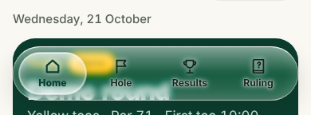

# Navigation check (`test/nav.run.js`)

Added 21 October 2026 for the Option 2 light navigation pill (issue #1). It judges the floating tab bar by what a golfer sees, in both looks, at 360px and 390px, at normal and 135% text, on Home, Hole entry, Results, Results › Buggy Wars and Ruling.

It fails when:

1. a tab is under 44 × 44, a label wraps or is cut off (the Hole tab is checked as "Hole 18", its longest label), or the bar leaves the screen;
2. scrolled to the end, anything tappable is still under the bar;
3. a label is below 4.5:1 against the pixels actually behind it. The labels are made transparent, the bar is screenshotted, and the worst pixel decides. This is done over the plain page and again over a pine band under the bar, which stands in for a pine card scrolling underneath.

Run: `python3 -m http.server 8765 -d dist & node test/nav.run.js standard.html editorial.html` after building both previews (see `.github/workflows/design-ci.yml`).

## Baseline: design head `da1cf3c`, before any nav change

[Full output](nav-check/before-da1cf3c.txt).

- Size, one line and nothing covered pass on every screen.
- Over the plain page, labels are 11–15:1.
- **Over a pine card, every label falls to 1.9–2.5:1, in both looks at every size.** The current glass bar is mostly see-through, so a pine hero scrolling underneath shows straight through it. Here is a real scroll on Home at 390px, not the simulated band:

The light pill therefore needs an opacity floor, or a solid fallback when pine is beneath, whatever else it does. The check is not in `design-ci.yml` yet, because it fails on the current head. It should be added in the same PR that makes it pass.

Linux Chromium is not an iPhone. Real backdrop blur, Home Screen mode (`styles.css` forces a solid white bar there) and sunlight still need the phone check.
