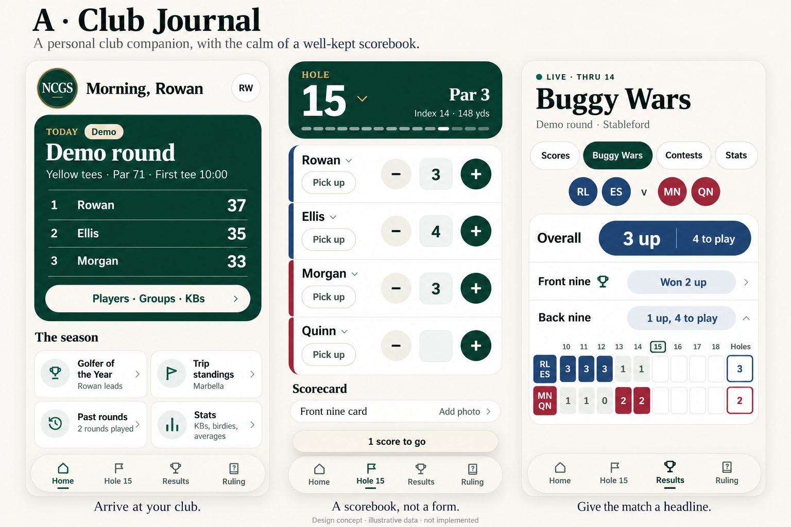
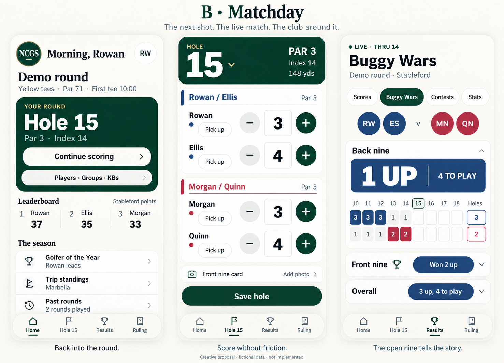

# Creative proposals — 23 October 2026

These are **AI-assisted illustrative concept mockups**, generated using genuine current app fixture renders as visual references. They are not screenshots of implemented changes, executable prototypes, approved designs, or evidence of usability/accessibility test passes.

Source app reviewed: released main `539be61ed2a0b98ed7a8c291c6e5b267ca10a3a9`. Genuine reference screens: Home, Hole and Buggy Wars at 390×844, using invented fixtures. These new boards use fictional sample players and states. Source code, scoring, data, main and the live app are unchanged.

## Creative diagnosis

The app has a coherent identity, but recurring heading/card/list compositions give different activities a similar rhythm. The stronger opportunity is to express three distinct experiences within the same family: arriving at the club, entering a score, and following a contest. Identity comes from composition and hierarchy as well as the crest and palette.

## A — Club Journal

A warmer, quieter, editorial companion. The key ideas are a personal crest/greeting masthead, an open ledger inside the pine round card, aligned scorebook rows and a more prominent competition headline.

Tradeoff: it is calmer for browsing, but Home still gives much attention to standings rather than the next scoring action. Its two-by-two season tiles are an **unapproved alternative** to the owner's chosen season list; they are not the recommendation. Keep the existing list unless the owner chooses otherwise.

## B — Matchday (revised proposal)

The stronger hierarchy for active golf:

- Home promotes **Continue scoring** to the existing Hole destination, using the known current hole; Players / Groups / KBs remains separate and reachable. The leaderboard supports the live action rather than dominating it.
- Hole keeps familiar minus/value/plus controls and gives score values a clear alignment. The example shows a completed state with Save hole.
- Buggy Wars gives the **open nine** a focal result and places its grid directly beneath it. Front nine and Overall remain distinct, visible matches; their scoring rules are not changed. The sample navy lead is 1 up in the back nine and 3 up overall, with four holes left.

Tradeoff: sporting emphasis can become shouty if every numeral is enlarged. Pair headers and repeated Par labels in the generated scoring screen may add redundancy; simplify those in a real prototype while preserving pair identification and touch targets.

## Recommendation

Explore **Matchday's hierarchy with Club Journal's warmth and typographic restraint**. Keep the selected crest, pine/ivory relationship, rare champagne, light four-route navigation and navy/crimson key. No new competitions or information architecture are proposed. KBs and Buggy Wars remain separate.

Start with one isolated Home composition and its existing return-to-scoring action, then compare it with the current app. Do not implement all imagery wholesale. Use real source components, correct dynamic states and the approved SVG crest; do not trace AI-generated text, icons or artwork.

If that exploration is taken forward, validate actual 360/390px and enlarged-text layouts, the same existing scoring behaviours and real-phone readability. These conceptual boards have **not** undergone those checks. Further direction or an aesthetic departure still belongs to the human owner.

No automated implementation command or queue entry accompanies these proposals.
