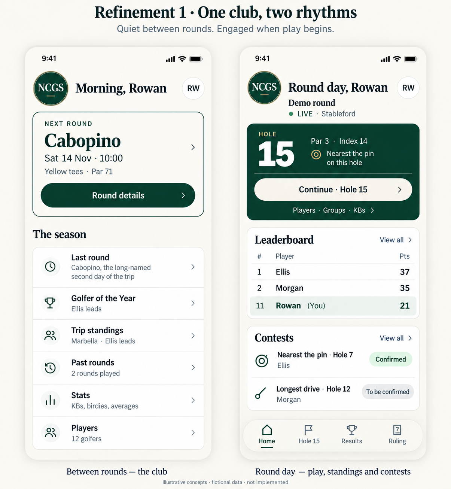
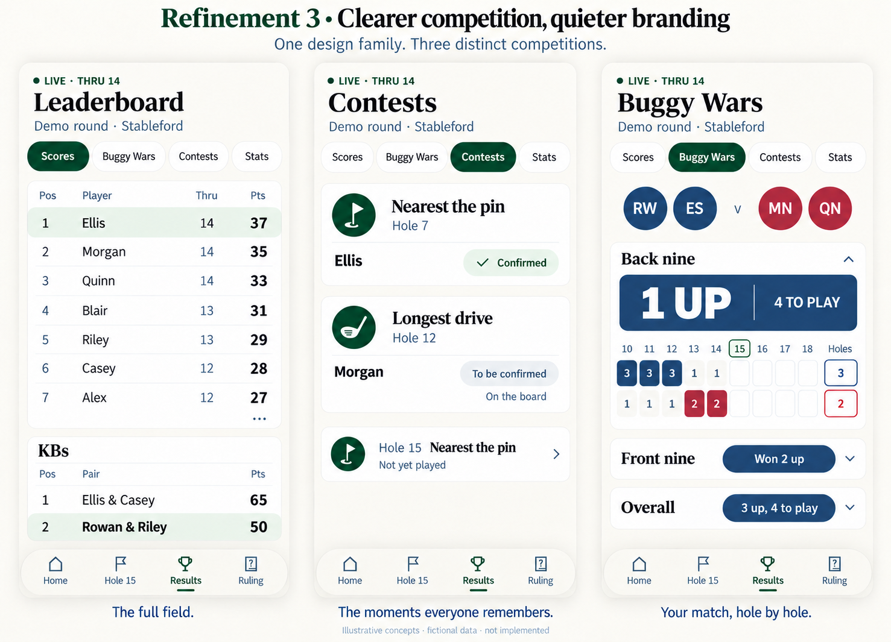

# Club character and matchday — three refinement passes

The owner endorsed the broad direction and requested several refinement levels, with meaningful importance for **nearest the pin, longest drive and the leaderboard**, and restraint between rounds. Exact screens and a release are not approved by that instruction.

These are **AI-assisted illustrative mockups**, not implemented screenshots or usability-test evidence. All names and results are fictional. Source baseline: released main `539be61ed2a0b98ed7a8c291c6e5b267ca10a3a9`.

## Pass 1 — check the actual states

We inspected genuine identified-live and quiet synthetic Home renders and the source. **Continue · Hole N already exists** for an identified playing group. The first unselected fixture concealed it; this corrects the initial critique. Its leaderboard preview also retains your position outside the leaders. Quiet Home hides play navigation.

The design refines the balance of existing behaviours, rather than adding a new scoring feature or a manual club/matchday switch.

## Pass 2 — compose quiet and live Home

Between rounds, an ivory next-round notice and personal masthead give space to the owner's selected season list.

During play, a compact pine scoring ticket shares attention with a readable leaderboard preview and visible nearest-the-pin / longest-drive states. The preview deliberately includes Rowan in 11th alongside the leaders: personal relevance should not depend on winning. The current hole's contest is signalled in the ticket; season content continues below.

## Pass 3 — challenge and simplify competition views

The independent reviewer challenged the first competition board. We removed repeated large crests from functional pages, made the not-yet-played contest a compact upcoming row, and corrected KBs ordering and its lowest-pair highlight.

- **Individual leaderboard:** clear rank/name/progress/points columns. The board abbreviates the field for illustration; preserve every player and real scrolling in implementation.
- **Contests:** full names, hole, claimant and explicit confirmation state. A provisional claimant is not crowned. The results view does not nominate winners or collect distances: the existing after-hole flow asks each group for a member or Nobody.
- **KBs:** separate cross-group pairs, totals ranked descending (65 then 50 here); retain the existing lowest-pair treatment on 50.
- **Buggy Wars:** the open nine's result and grid belong together. Front nine and Overall stay separate and visible. The sample navy side wins three of five played back-nine holes, so it leads that nine 1 up with four left; the front-nine and overall results remain distinct. Keep the approved colour-only leader pills and existing screen-reader treatment.

## Recommendation

Explore the quiet/live Home and final competition board as one coherent family: personal club warmth, stronger context-specific matchday priorities. Preserve source controls, shot dots, Stableford details, dynamic states and the approved SVG. Simplify duplicated pair headings from the earlier scoring mockup without losing pair identification.

Use a working prototype to check real 360/390px, enlarged text, long names, unknown-player fallback, incomplete/complete score entry and all contest states. These boards have **not** passed those checks or a real-iPhone review. Generated artwork and text metrics are not production assets.

Only documentation and concept PNGs accompany this work. No source/data changes, implementation trigger, queue change, main write or deployment. The required engine/server command on the verified source snapshot exited 0 (two file entries, zero failures in Node24); it does not validate the mockups.
