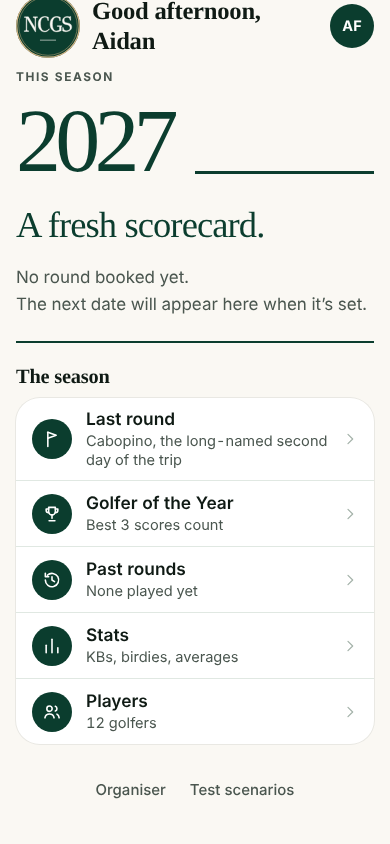
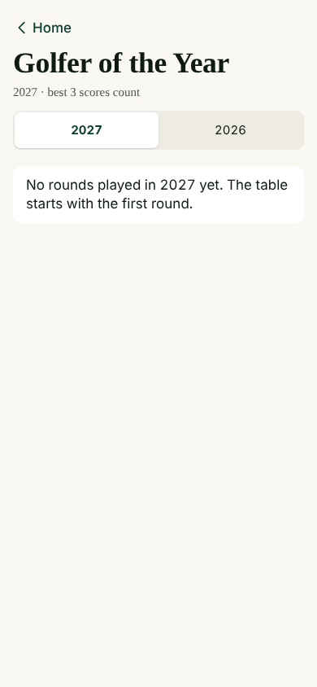
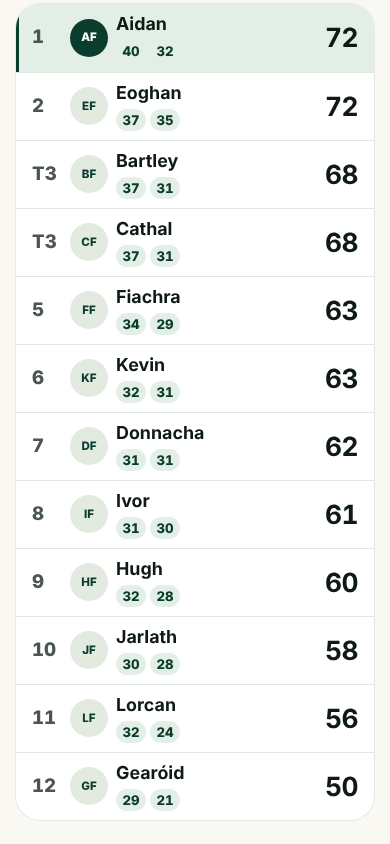
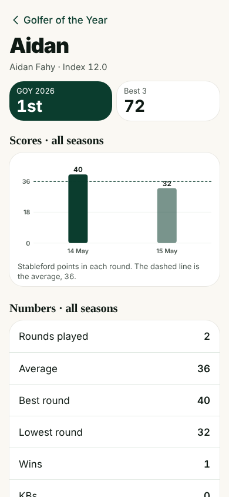
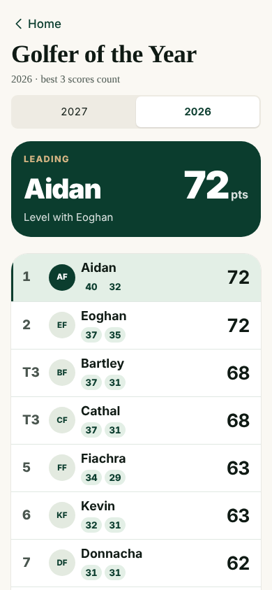
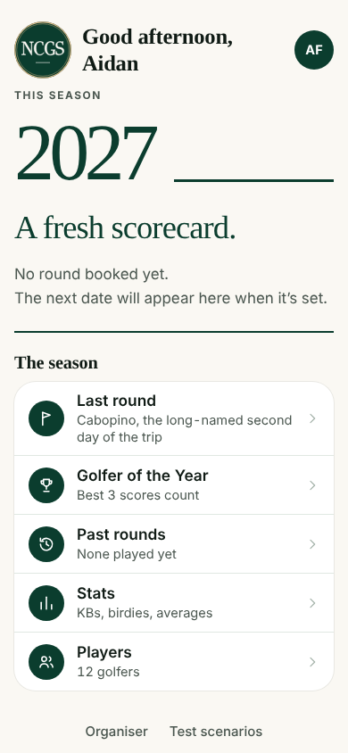
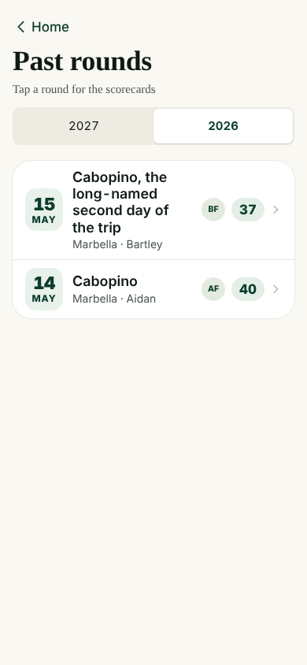
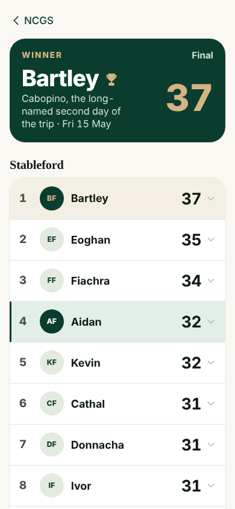
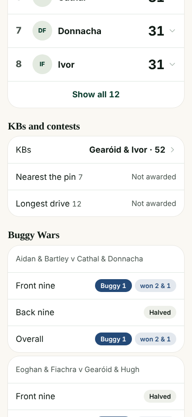
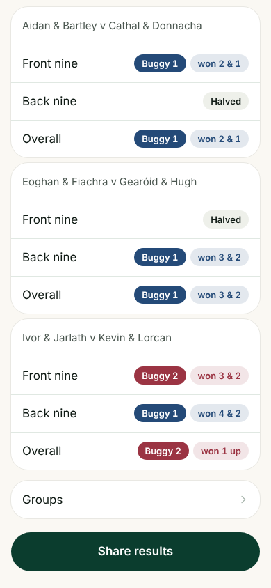

# 1. A member opens the app in a new, empty season, looks back at last season, and comes back

**Who:** a member

Each frame is the screen as it looked straight after the action in its caption (fixed screen size, real scrolling).

1. **Member phone**: Opens the app: new season, nothing booked yet  
   
2. **Member phone**: Home (scrolled)  
   
3. **Member phone**: Taps Golfer of the Year  
   
4. **Member phone**: Switches to last season  
   
5. **Member phone**: Last season's table (scrolled)  
   
6. **Member phone**: Opens a player from last season  
   
7. **Member phone**: Back: does it keep last season?  
   
8. **Member phone**: Back again: Home  
   
9. **Member phone**: Past rounds  
   
10. **Member phone**: Opens a past round  
   
11. **Member phone**: Past round (scrolled)  
   
12. **Member phone**: Past round (scrolled)  
   
13. **Member phone**: Home  
   
