# 2. The organiser sets up an outing, picks who's playing, makes groups and KBs, changes things before play; a member sees it

**Who:** Michael (phone) and a member (phone)

Each frame is the screen as it looked straight after the action in its caption (fixed screen size, real scrolling).

1. **Member phone**: Member: Home before anything is announced  
   
2. **Organiser phone**: Organiser: opens Organiser with the PIN  
   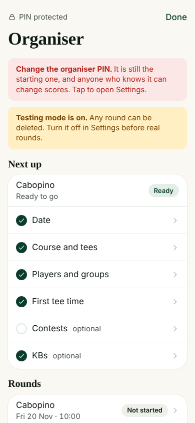
3. **Organiser phone**: Organiser home (scrolled)  
   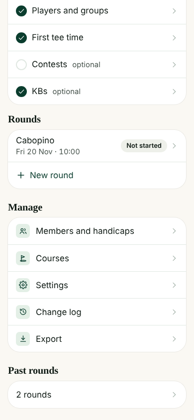
4. **Organiser phone**: Taps New round  
   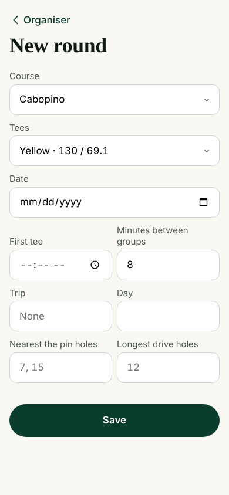
5. **Organiser phone**: Fills in name and date  
   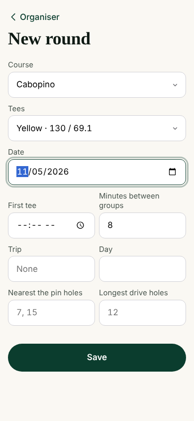
6. **Organiser phone**: Saves the round  
   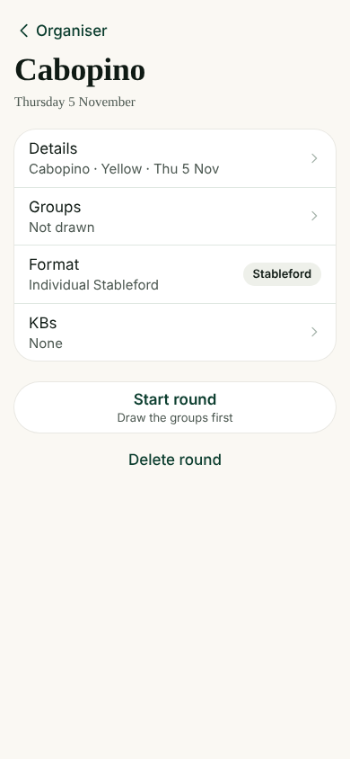
7. **Member phone**: Member: Home after the round is announced  
   
8. **Organiser phone**: Taps Groups: who's playing  
   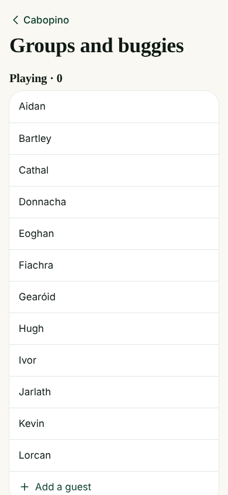
9. **Organiser phone**: Ticks 10 players  
   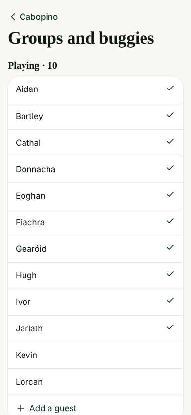
10. **Organiser phone**: Players list (scrolled)  
   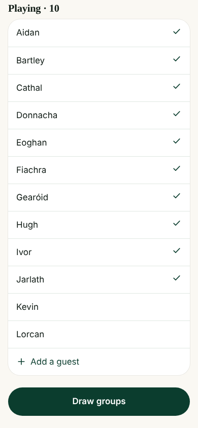
11. **Organiser phone**: Adds a guest  
   
12. **Organiser phone**: Guest saved, back to the list  
   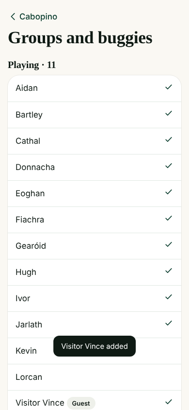
13. **Organiser phone**: Draws groups  
   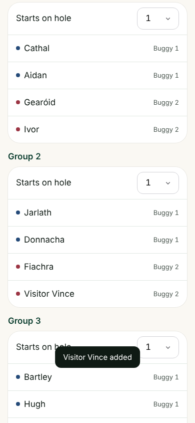
14. **Organiser phone**: Drawn groups (scrolled)  
   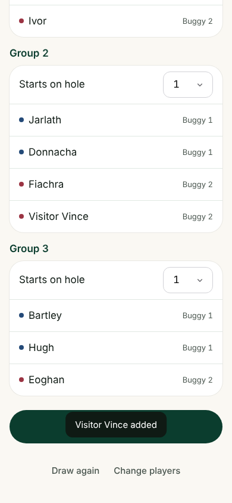
15. **Organiser phone**: Saves groups (KB pairs made too)  
   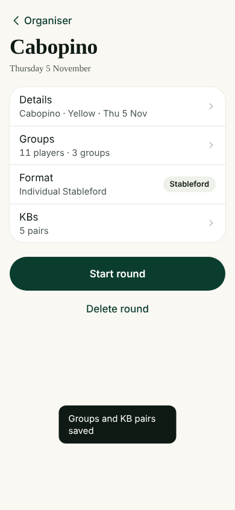
16. **Organiser phone**: Looks at the KB pairs  
   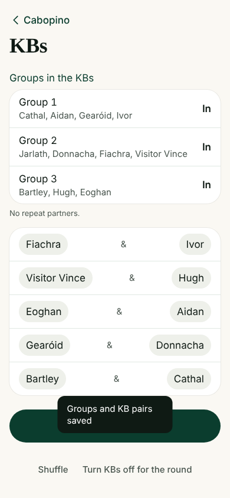
17. **Organiser phone**: Opens Groups to change something before play  
   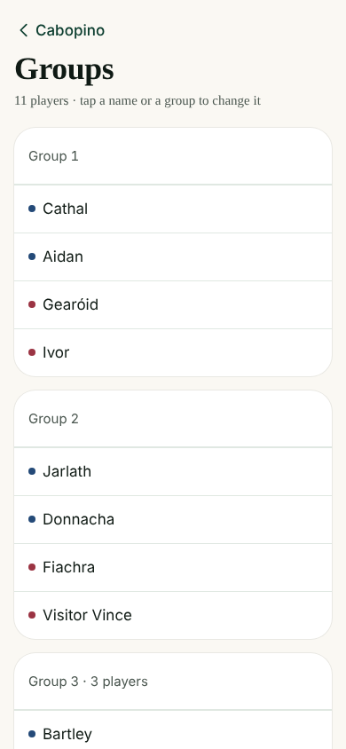
18. **Organiser phone**: Taps a player who will be late  
   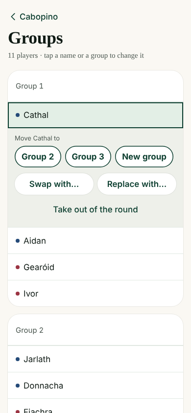
19. **Organiser phone**: Moves them to the last group  
   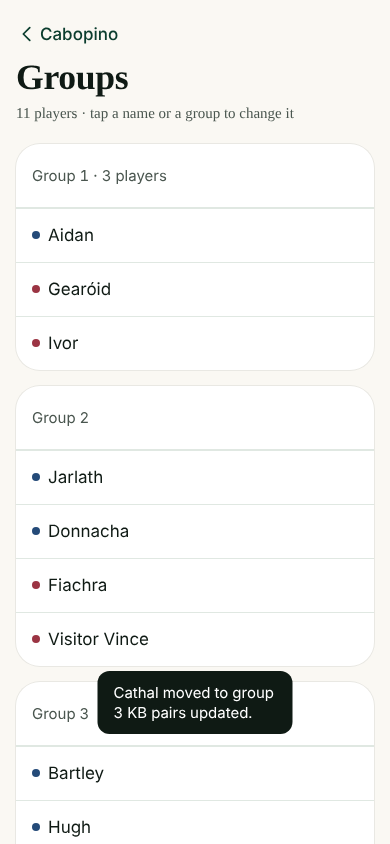
20. **Member phone**: Member: Home after the groups are out  
   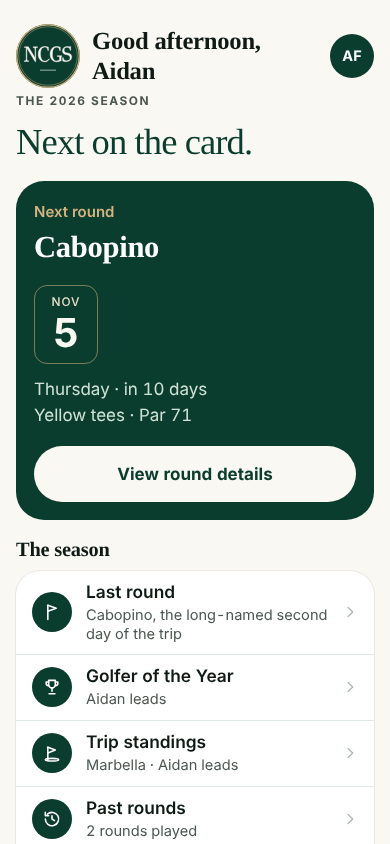
21. **Member phone**: Member Home (scrolled)  
   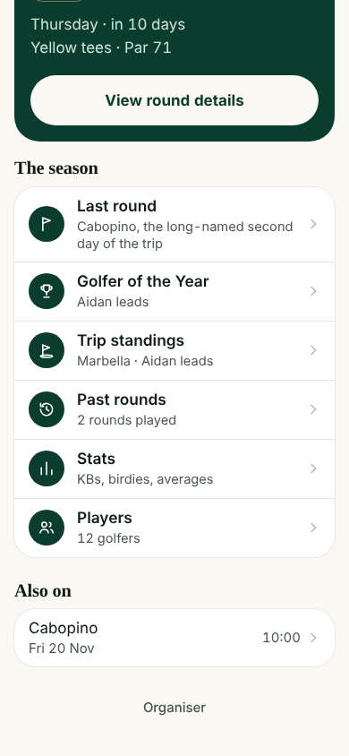
22. **Member phone**: Member: opens the round  
   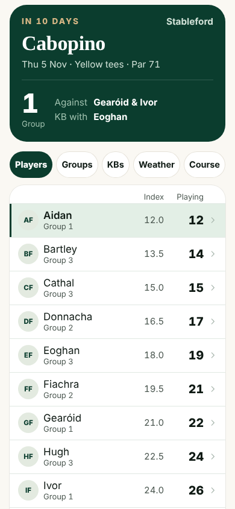
23. **Member phone**: Member: Groups tab  
   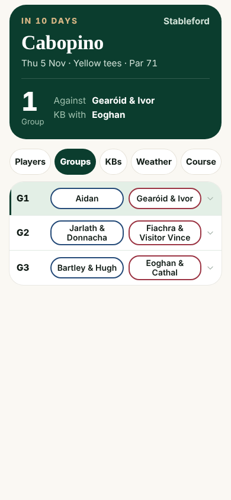
