# 3. A golfer gets to their group, scores, checks the board and contests, loses signal, reloads, and carries on from another phone

**Who:** a golfer scoring for their group (two phones)

Each frame is the screen as it looked straight after the action in its caption (fixed screen size, real scrolling).

1. **Scorer's phone**: Opens the app on the morning (not yet said who they are)  
   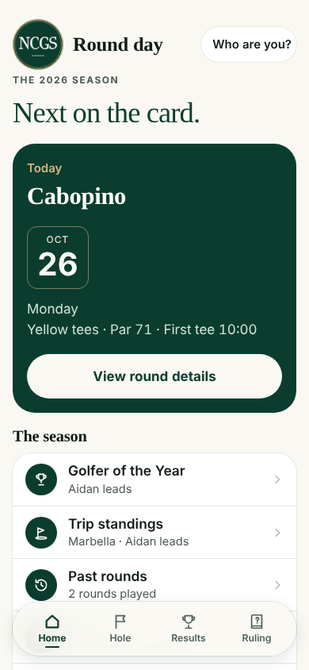
2. **Scorer's phone**: Taps "Who are you?"  
   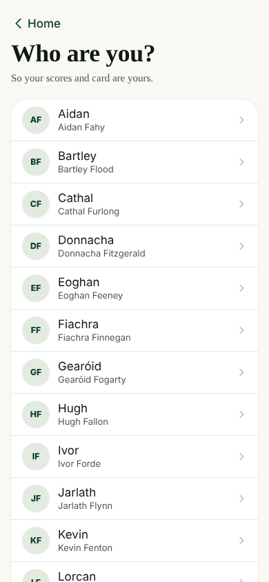
3. **Scorer's phone**: Picks their name  
   
4. **Scorer's phone**: Home: their day  
   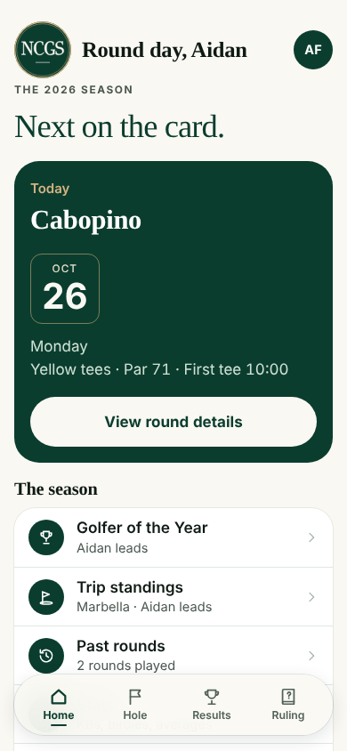
5. **Scorer's phone**: Home (scrolled)  
   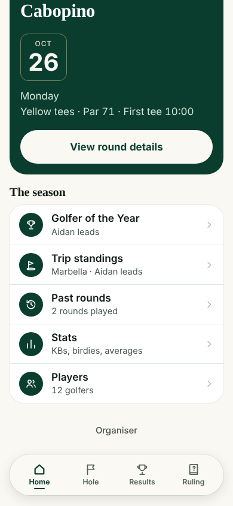
6. **Scorer's phone**: Opens the round  
   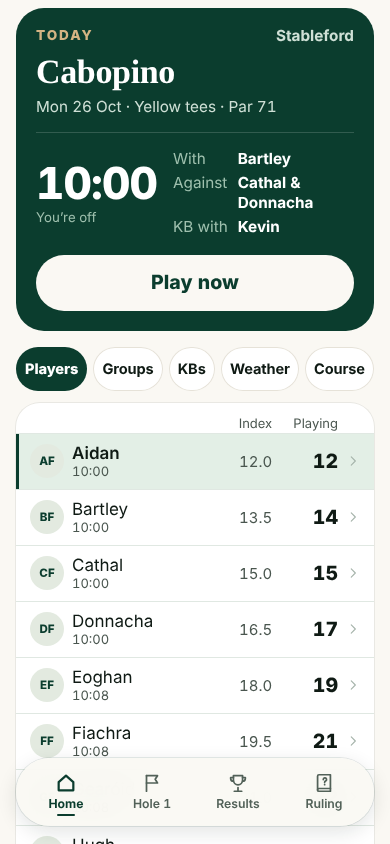
7. **Scorer's phone**: Play now  
   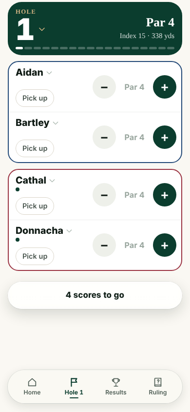
8. **Scorer's phone**: Hole 1: taps + once for each player (par)  
   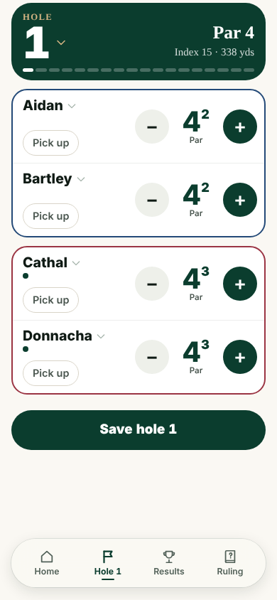
9. **Scorer's phone**: Saved hole 1  
   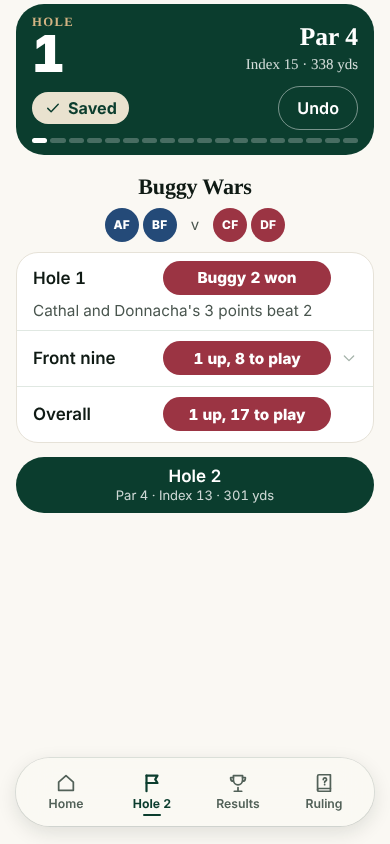
10. **Scorer's phone**: Hole 2 entered  
   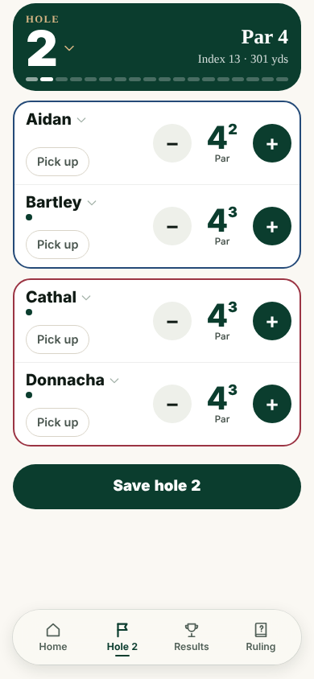
11. **Scorer's phone**: Saved hole 2  
   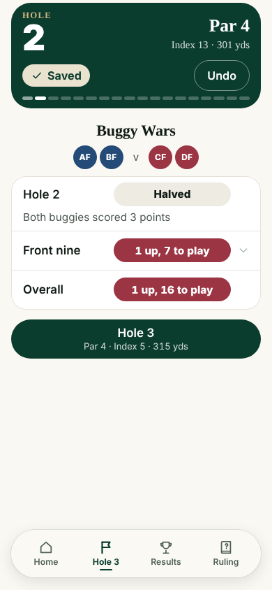
12. **Scorer's phone**: Checks Results  
   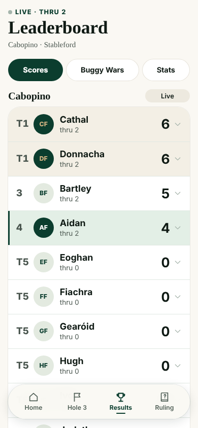
13. **Scorer's phone**: Results (scrolled)  
   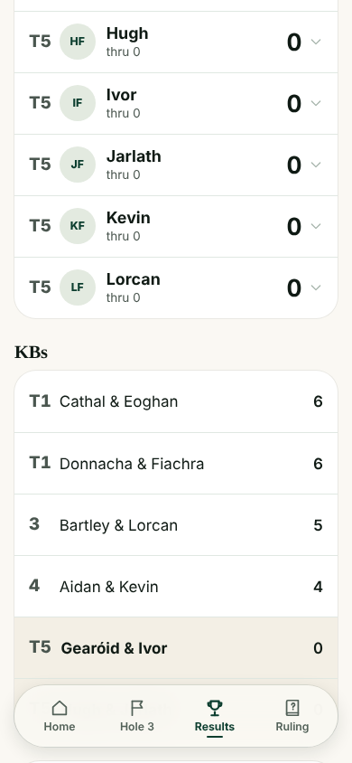
14. **Scorer's phone**: Results (scrolled)  
   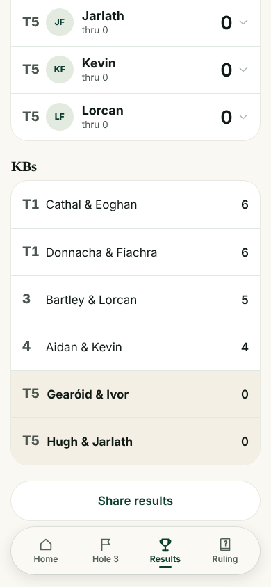
15. **Scorer's phone**: Back to the Hole tab  
   
16. **Scorer's phone**: No signal: enters hole 3  
   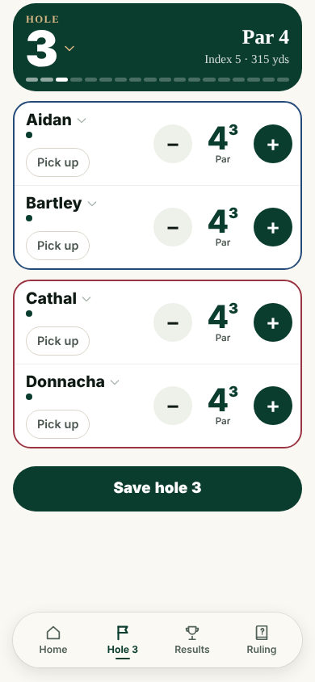
17. **Scorer's phone**: Saved hole 3 with no signal  
   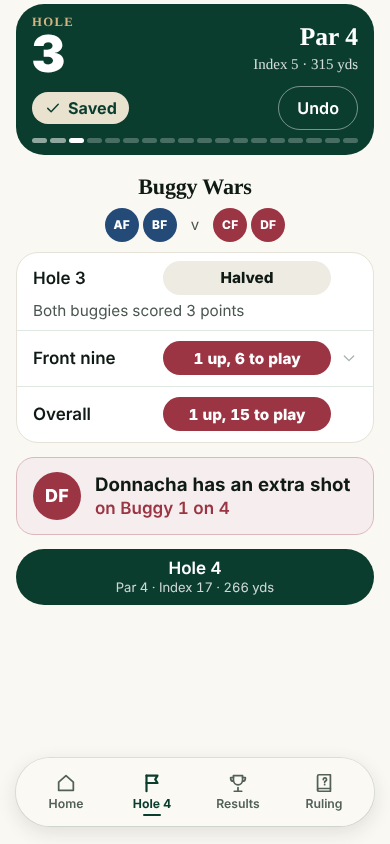
18. **Scorer's phone**: Phone restarts the app with no signal  
   
19. **Scorer's phone**: Signal back, app reopened  
   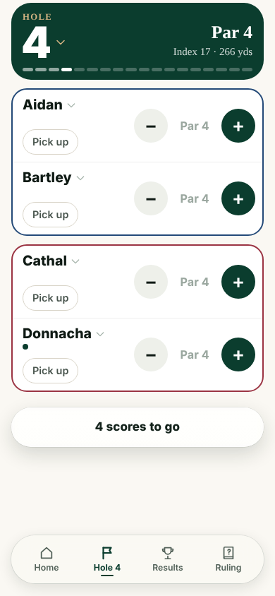
20. **Second phone**: Second phone opens the app  
   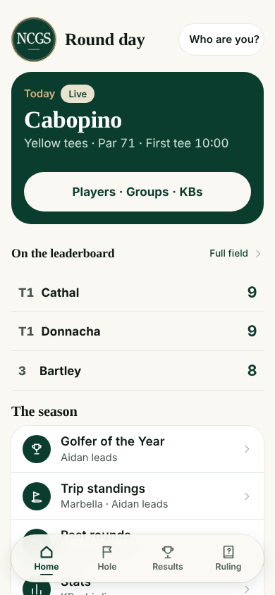
21. **Second phone**: Says who they are: Home  
   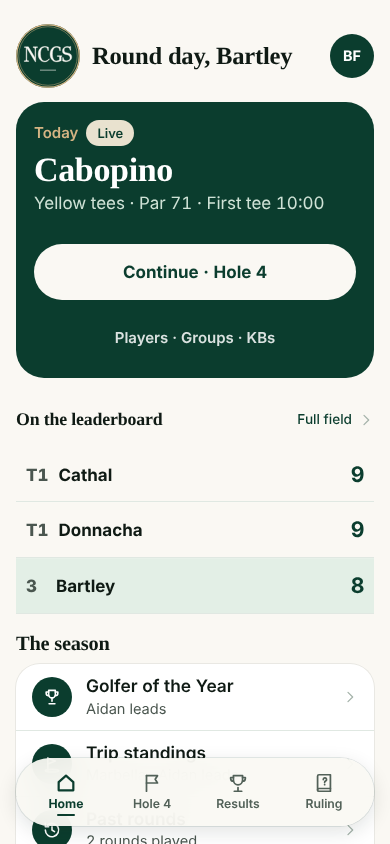
22. **Second phone**: Taps Continue / the Hole tab  
   

## Notes from recording

- Results had no Contests pill in this round.
- Frame "restarts the app with no signal" is blank because these recordings switch the offline app cache (service worker) off; on a real phone the installed app opens from its cache. Not evidence either way.
- After signal came back, the server had 4 scores for hole 3.
