# 6. The organiser confirms contests, checks cards, finalises, then corrects a mistake

**Who:** Michael (phone)

Each frame is the screen as it looked straight after the action in its caption (fixed screen size, real scrolling).

1. **Organiser phone**: The live round  
   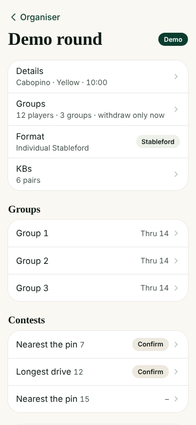
2. **Organiser phone**: Live round (scrolled)  
   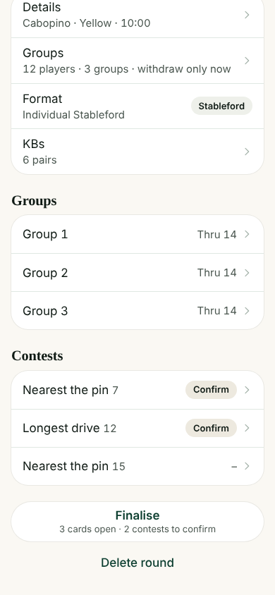
3. **Organiser phone**: Taps Finalise early  
   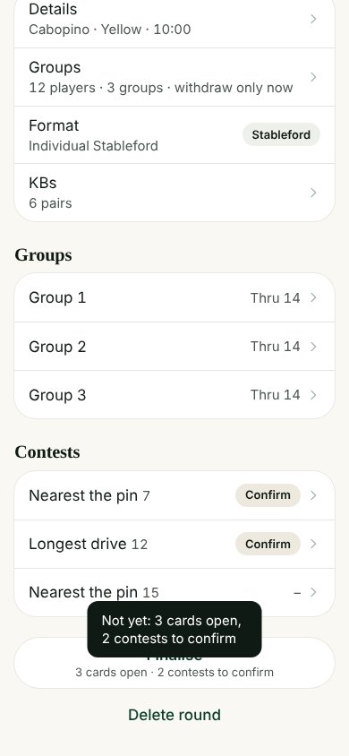
4. **Organiser phone**: Every group finishes their 18 (simulated)  
   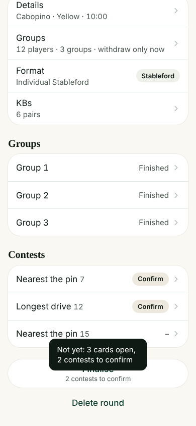
5. **Organiser phone**: Opens a contest to confirm  
   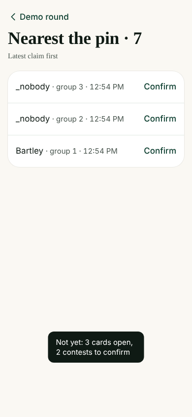
6. **Organiser phone**: Confirms the winner  
   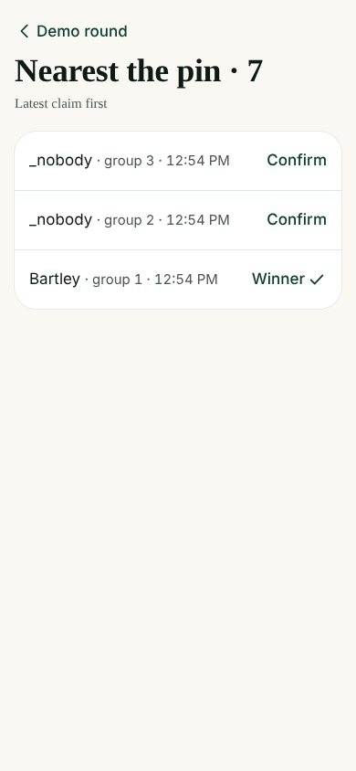
7. **Organiser phone**: Back to the round  
   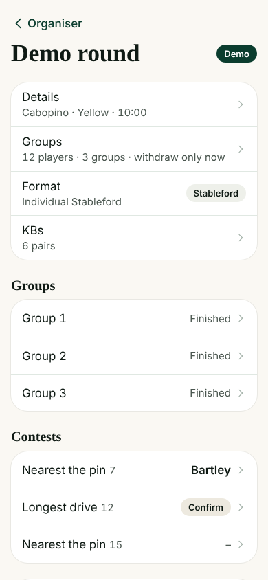
8. **Organiser phone**: Opens a group's card  
   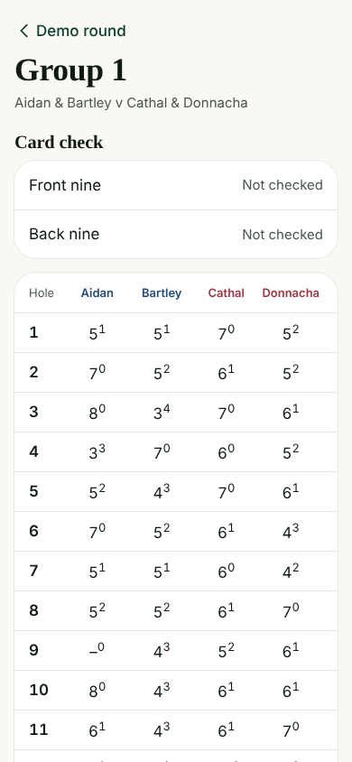
9. **Organiser phone**: Card (scrolled)  
   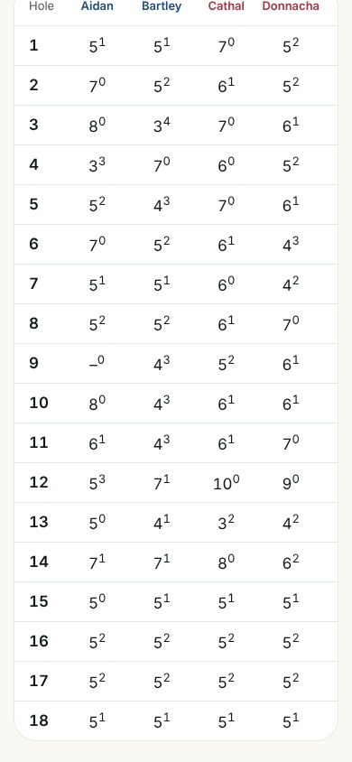
10. **Organiser phone**: Taps a hole to correct it  
   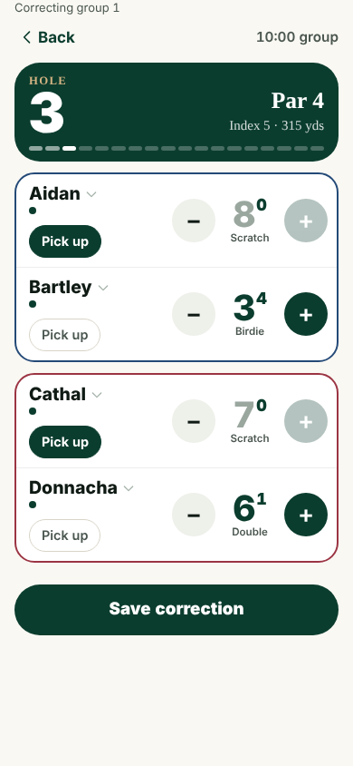
11. **Organiser phone**: Corrects and saves  
   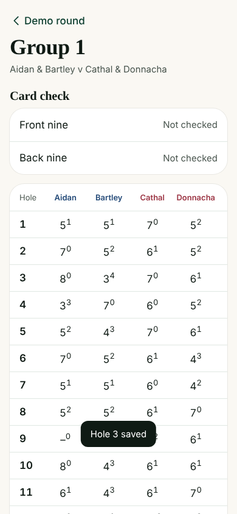
12. **Organiser phone**: Back  
   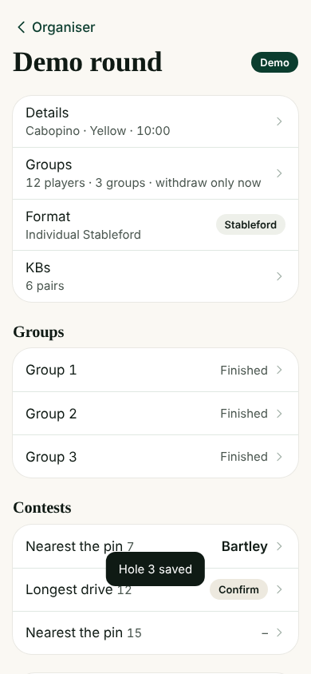
13. **Organiser phone**: Confirms the second contest  
   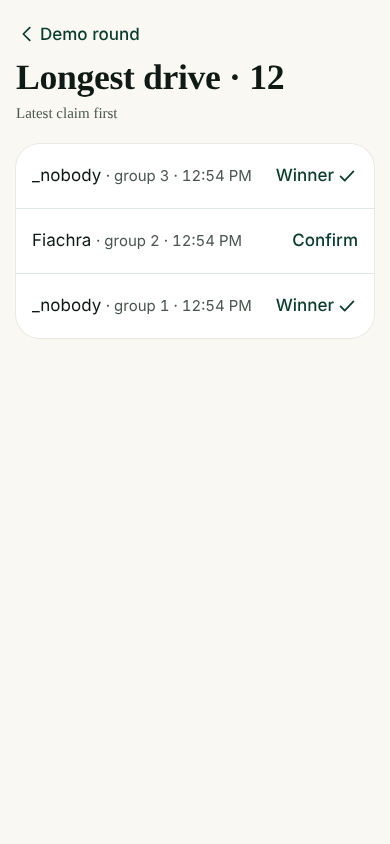
14. **Organiser phone**: Back to the round  
   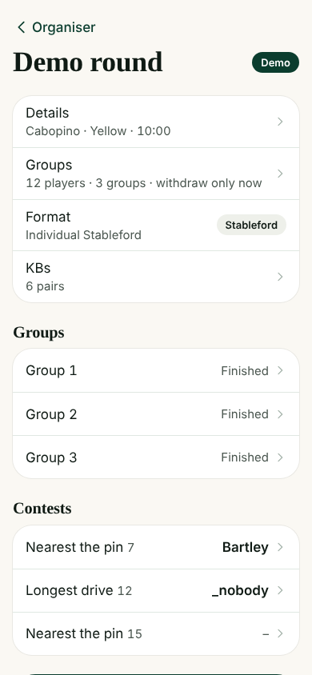
15. **Organiser phone**: Round (scrolled)  
   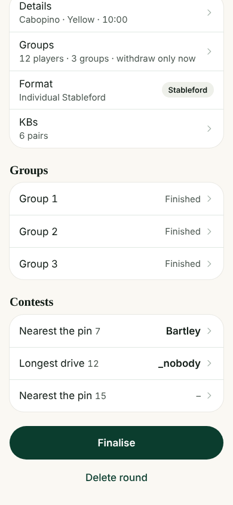
16. **Organiser phone**: Finalise  
   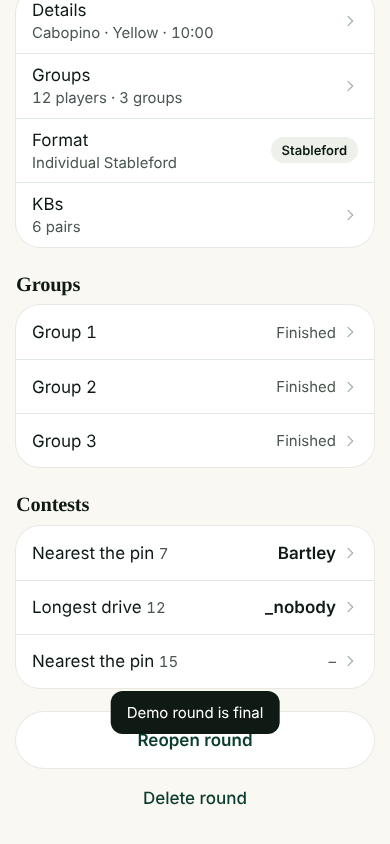
17. **Organiser phone**: Finalise again (if it asked)  
   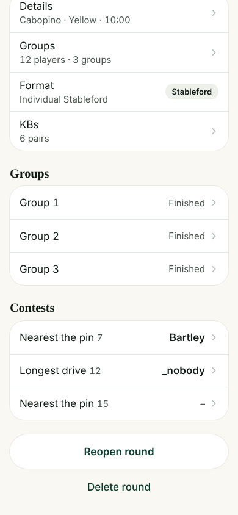
18. **Organiser phone**: Home after finalising  
   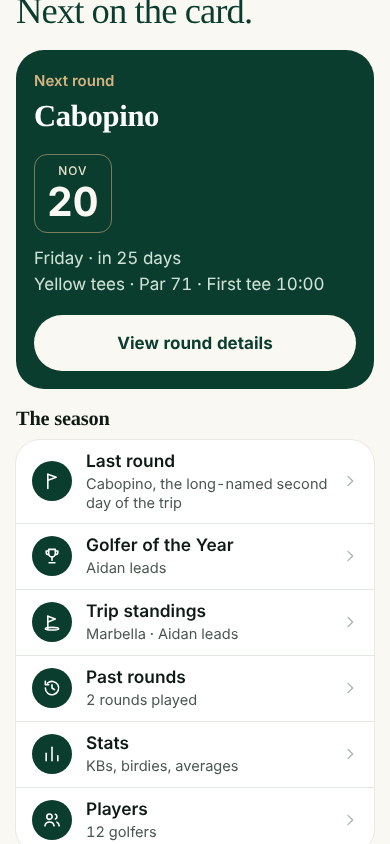
19. **Organiser phone**: Home (scrolled)  
   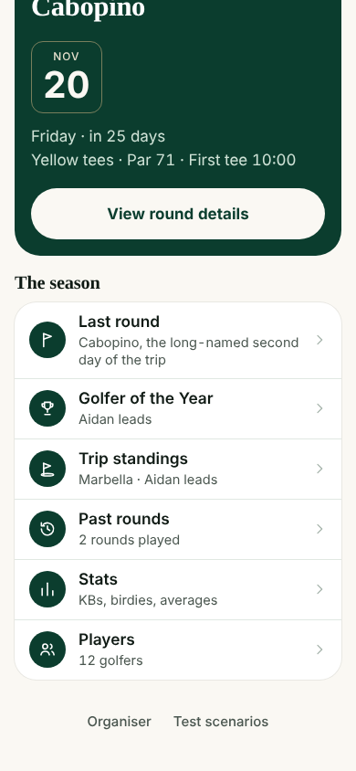
