# 7. Westport finishes: last team saves, KBs, the organiser confirms and finalises

**Who:** a team scorer and Michael (phones)

Each frame is the screen as it looked straight after the action in its caption (fixed screen size, real scrolling).

1. **Team phone**: Team 1 on the 18th; the others have finished  
   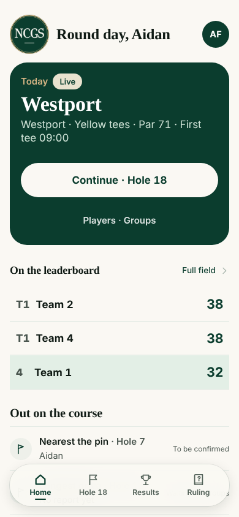
2. **Team phone**: Continue · Hole 18  
   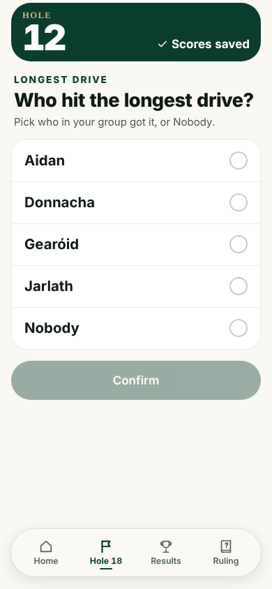
3. **Team phone**: First answers the longest-drive question it skipped  
   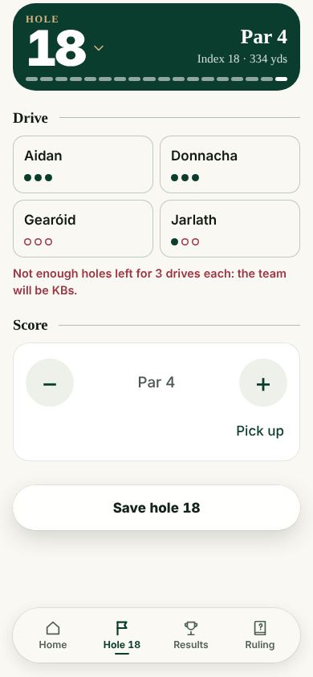
4. **Team phone**: Drive and score for 18  
   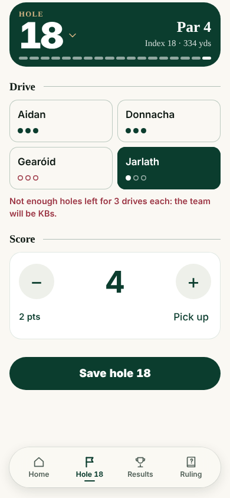
5. **Team phone**: Saves the last hole  
   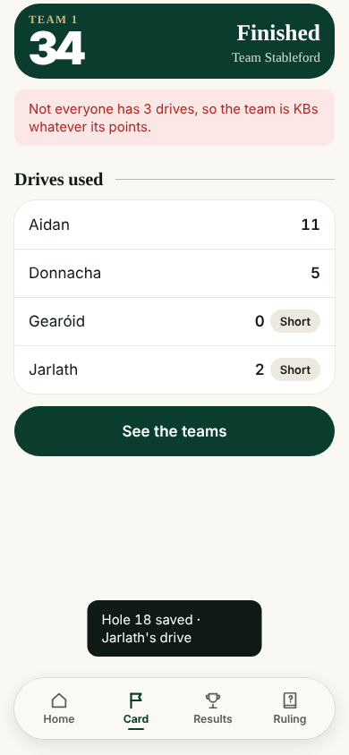
6. **Team phone**: Home: all in  
   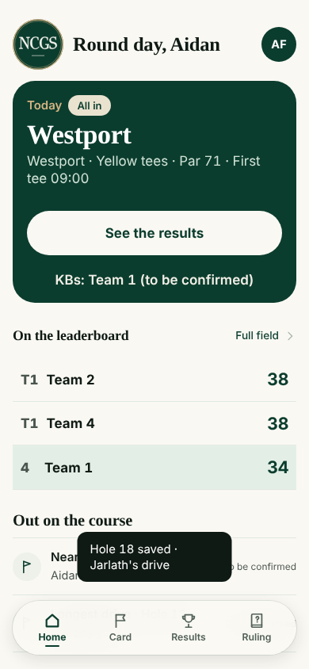
7. **Team phone**: Home (scrolled)  
   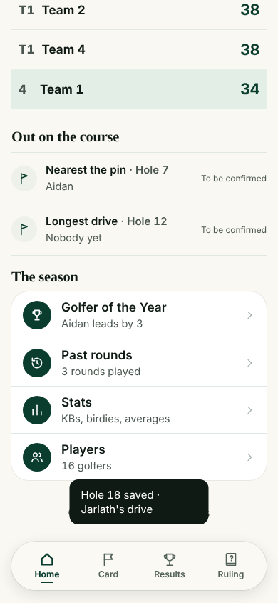
8. **Team phone**: See the results  
   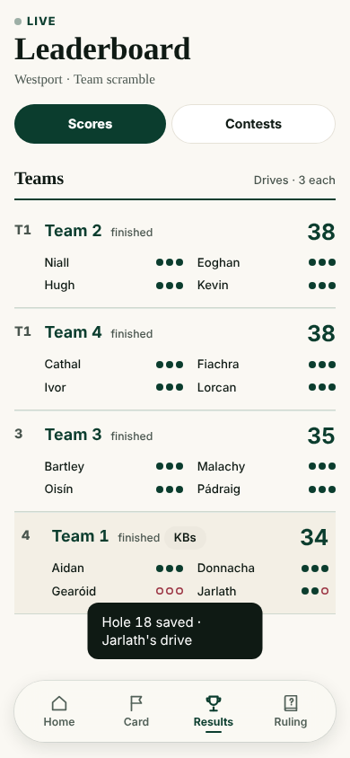
9. **Team phone**: Organiser: the round  
   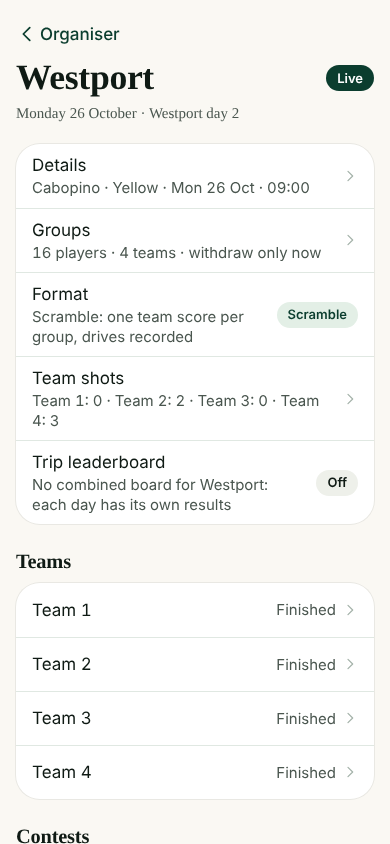
10. **Team phone**: Round (scrolled)  
   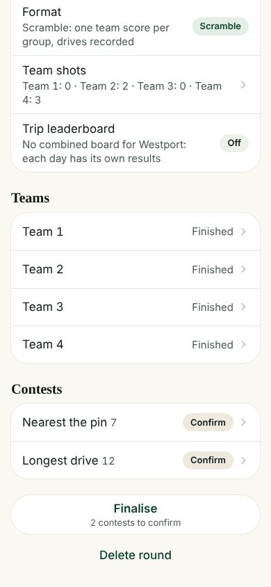
11. **Team phone**: Finalise  
   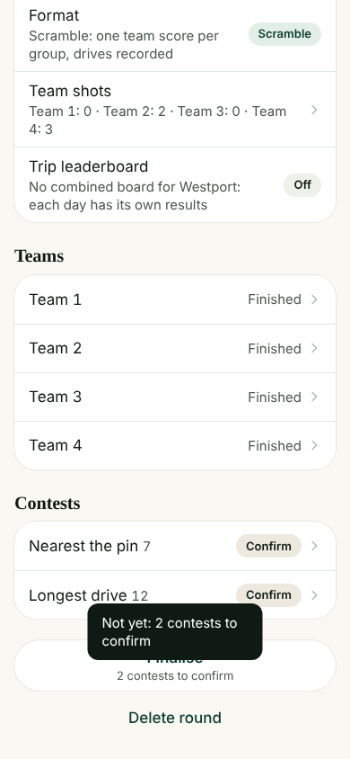
