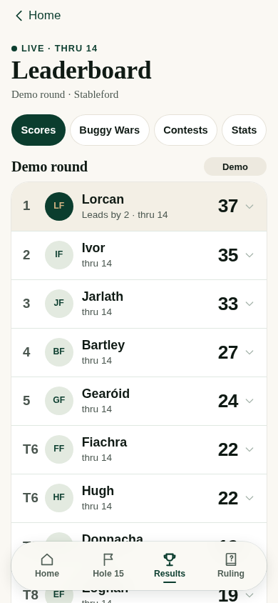
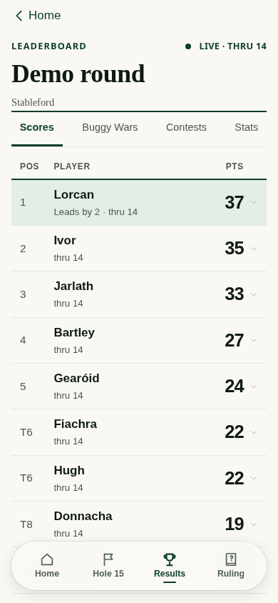
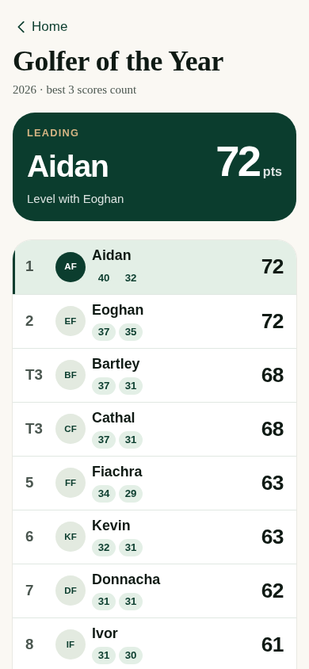
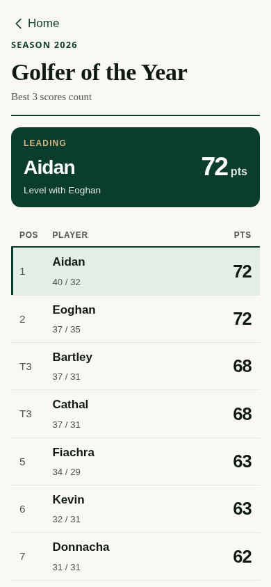
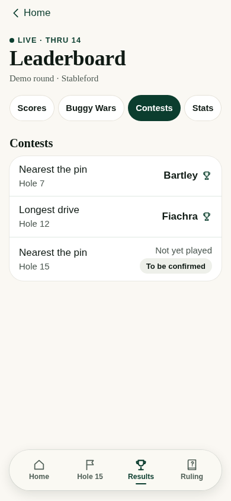
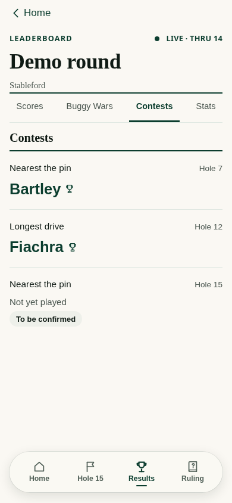
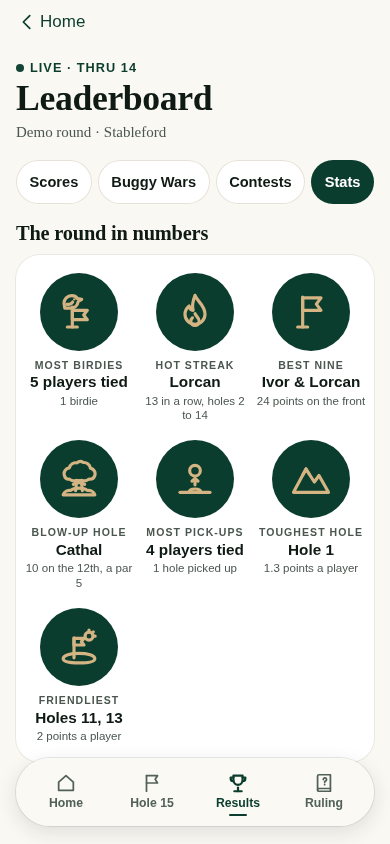
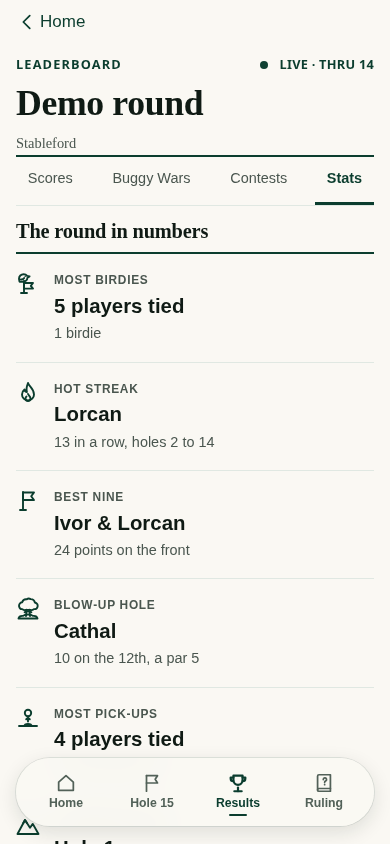

# Results refinement — 29 October 2026

A working-app design candidate based on released main `b2d849d`. The owner asked for a more professional results experience while retaining Modern Club Character. These are real Chromium renders of the app using fictional fixtures, not generated mockups.

## Design decisions

- **The competition leads.** The course replaces the generic large Leaderboard title; Leaderboard and live/final state remain in a small masthead. Format/date sit underneath. The repeated round-title section is removed.
- **Scores read as a ledger.** Rank, player and points have aligned column headings. Initials circles are removed from these standings, with full player names and progress retained. A quiet first-row tint and pine rule establish the hierarchy. Tap-to-expand scorecards still work.
- **Results navigation is quieter.** Underlined text tabs replace four competing outlined pills within this screen. The main glass navigation and primary action buttons retain their approved forms. Selection remains explicit and touch targets remain generous.
- **The season belongs to the same family.** A clear season label, restrained leader panel and matching standings replace the oversized summary and collection of score badges. Counting scores remain visible as simple separated values; archive controls and eligibility are unchanged.
- **Contests celebrate the result.** Each contest names the challenge and hole, then gives the golfer's name the prominence. Existing provisional, confirmed, nobody and waiting states are retained; no winner is inferred from an unfinished contest.
- **Stats become a match report.** Full names and performances carry the hierarchy, with small pine line marks replacing oversized gold-on-green medals. All existing facts remain. A wider screen uses two columns.
- **Scramble keeps its own story.** Team drive ledgers and KB emphasis remain; its surface adopts the same quieter rules. No individual result, winner celebration or combined Westport leaderboard is introduced.

The existing scoring calculations, data, finalisation guards, offline queue, handlers and destinations are unchanged. This is a presentation contribution, not a new product workflow.

## Actual before and after

All pairs show the same fixture and 390px phone width. Full-page images include below-the-fold content; floating navigation remains viewport-fixed in real use.

| Screen | Before | Candidate |
| --- | --- | --- |
| Scores |  |  |
| Season |  |  |
| Contests |  |  |
| Stats |  |  |

## Validation and integration

The PR description records exact completed checks. Genuine screens were examined at 360px, 390px and 135% text, with additional long-name fixtures. Local browser execution uses installed Chromium and a loopback adapter; it does not prove physical-iPhone fonts, sunlight readability or VoiceOver behaviour.

The source-only candidate intentionally leaves the committed published `site/` unchanged under the repository's design-source protection. The new `check-site.js` safeguard correctly blocks a production-target merge until Claude prepares the separately reviewed release build. That check is preserved; this draft is not permission to merge or deploy. The integration request is sent directly through Issue #1, without an owner relay.
