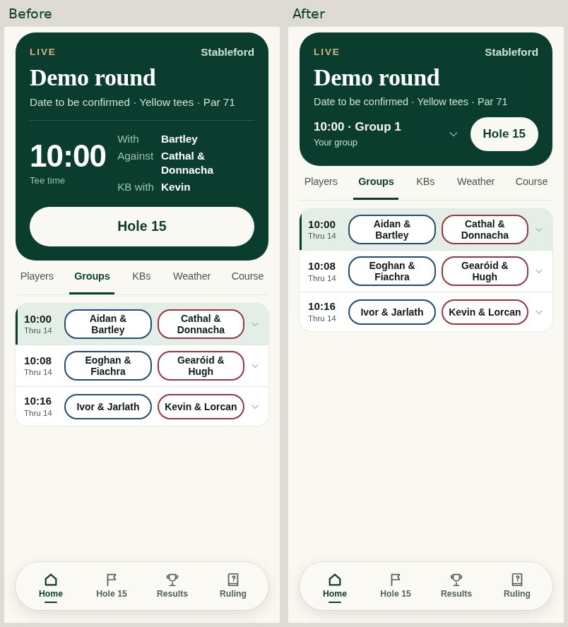
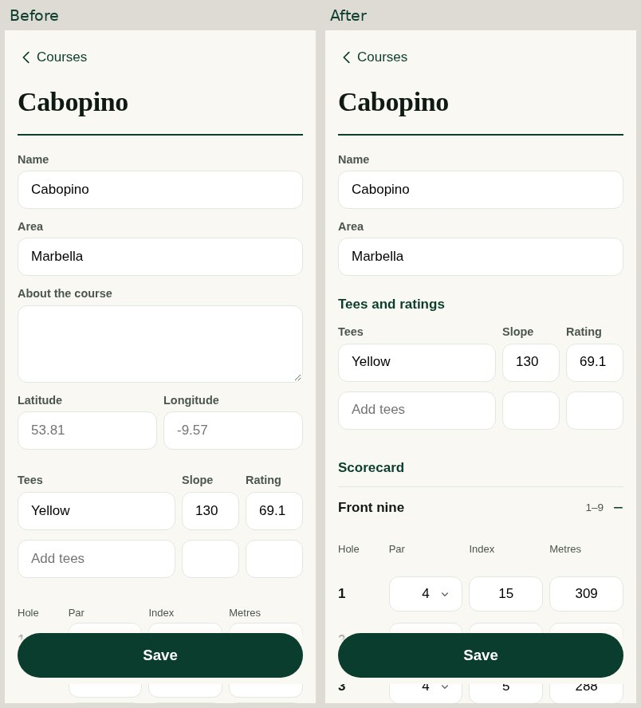
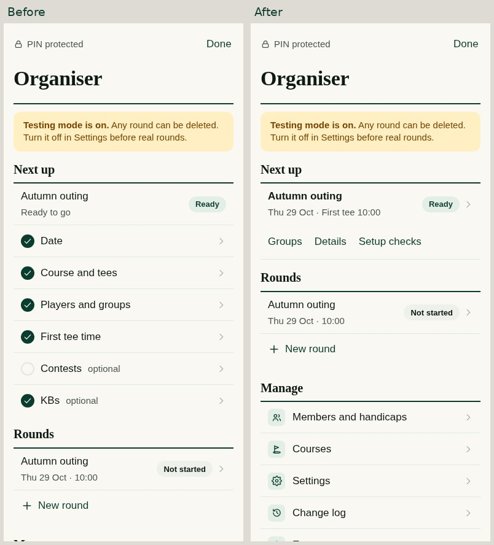
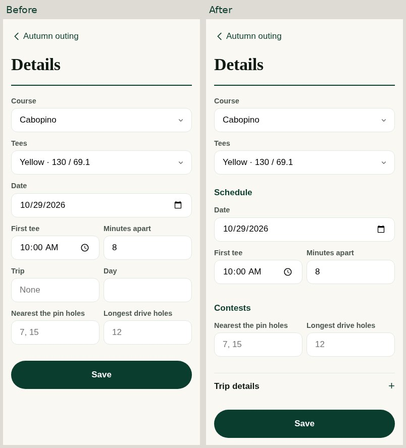
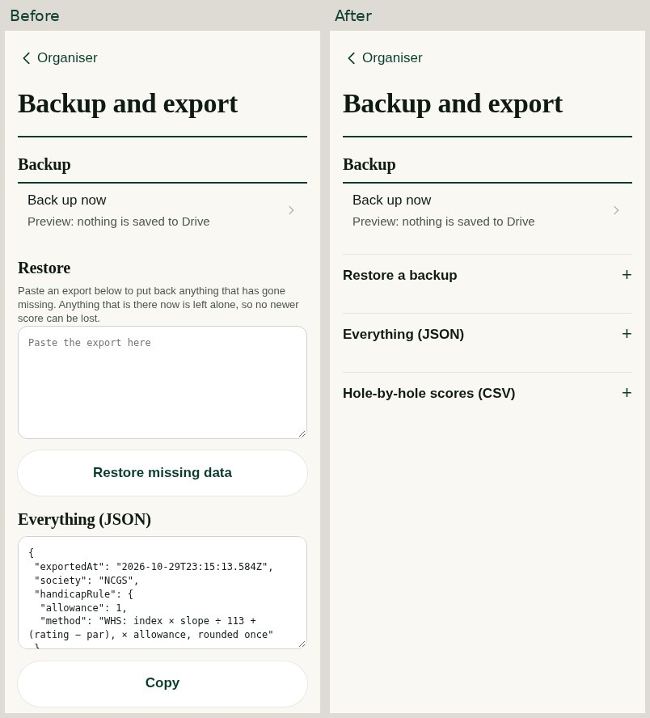
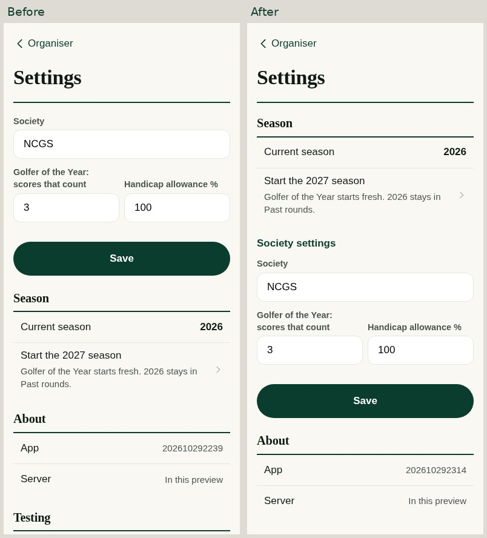
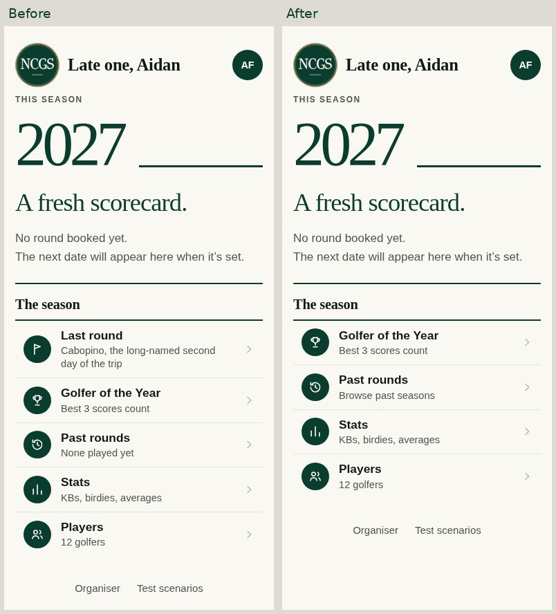
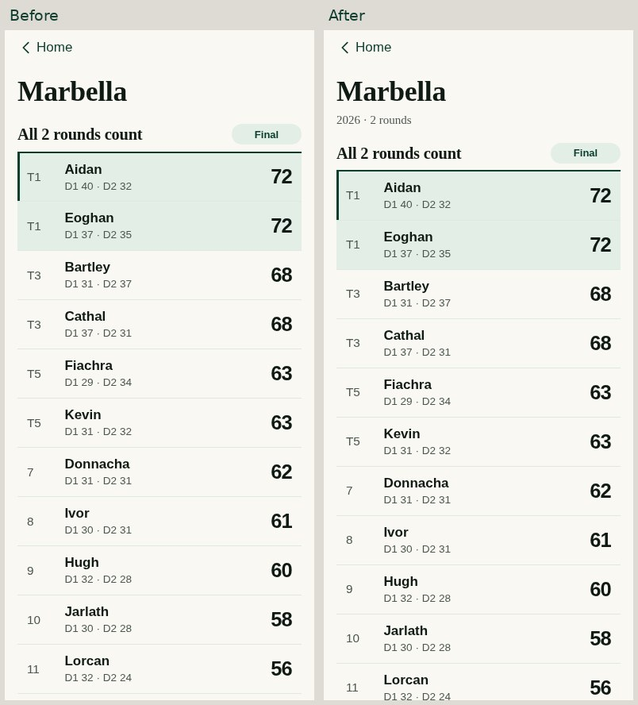

# Screen design and workflow review — 29 October 2026

The shared identity in #63 was necessary but did not complete Michael’s request. This continuation makes an explicit composition and purpose decision for every current renderer and implements the unresolved screen and journey changes. It builds on #63 at `3f4778f9fd50a2219e5770c8f726684167248d4a`, preserving #62’s results improvements.

## Design judgement

The app should feel like one club, with different intensity for different jobs. Keep the strong editorial year/crest on quiet Home, pine orientation for a live round, tabular sans-serif for names and results, and conspicuous wheels for the breakfast draw. Carry the same palette, type roles, section rules, spacing and controls into routine screens. Organiser screens should get the essential task into view, preserve entered work and make exceptional operations deliberate. Uniform branding does not mean every screen needs the same hero card.

This register is an assessment of the current application, not a new task queue. **Refine** means implemented in this contribution; **Keep** is an affirmative decision against the screen’s actual job after source/screen review, not a CSS inheritance claim. Helpers, delegates and older routes are marked rather than counted as independent member journeys. Native-device/service limits are listed separately.

## Implemented, observable changes

- Round context compresses to course/status/tee time/group and the actual resume action. Your group expands when wanted; selected tabs get more space. With, Against and KB with remain separate; scramble shows three teammates.
- Course editing now proceeds essentials → tees → front/back scorecard → optional description/location. Both nines stay in the form, independent open sections survive redraw, and all edited fields survive validation. Standard invalid-coordinate bounds are explained without losing the draft.
- Round setup separates schedule and contests from optional trip metadata. Switching course preserves schedule/trip, while tee choices still come from the selected course. Out-of-range contest holes are explained rather than silently dropped.
- Ready organiser rounds become a compact useful summary with Groups/Details and optional setup checks. Missing optional items are accurately marked optional.
- Season opening leads Settings. New-season Home no longer presents last season’s Last round under The season; its Past rounds link explicitly offers past seasons before the first new round.
- Completed rounds link to their trip. Trip headings show season; opening a golfer from an archived trip preserves that season. Westport remains separate daily results, without a combined leaderboard.
- Backup leads with Back up now. Restore/JSON/CSV are separate disclosures; pasted restore text survives a redraw. The existing explicit second confirmation and missing-data merge safeguards remain.
- Manual nine-card comparison keeps named column headings visible while the golfer scrolls.
- Form errors are keyboard-focusable alerts brought into view. Only edited ordinary fields are preserved on the same route; no PIN/password/file, read-only export, durable store or score queue is copied. Text selection also survives an incidental redraw.

## Before and after

All images are actual Chromium app screenshots with invented golfers, never generated mockups or live member data. Comparisons use the frozen #63 baseline. The eight before/after pairs are final selected captures; the full inventory contact sheets were captured before the final optional-check/error-focus/Home polish. Those final changes are verified by the selected captures and regression journeys.

### Composition comparisons at 390px

| Round detail: more content in view | Course: card entry comes forward |
|---|---|
|  |  |

| Ready organiser round | Schedule and contests |
|---|---|
|  |  |

| Backup and export | Season first in Settings |
|---|---|
|  |  |

| Fresh season with a clear archive route | Archived trip with season context |
|---|---|
|  |  |

### Actual interaction states

[Expanded personal group](assets/screen-design-20261029/round-expanded.jpg), [validation with retained course work](assets/screen-design-20261029/course-error.jpg), [round validation](assets/screen-design-20261029/details-error.jpg), [restore’s second confirmation](assets/screen-design-20261029/restore-confirm.jpg), [archived round → trip](assets/screen-design-20261029/archive-round.jpg), [trip → correct-season profile](assets/screen-design-20261029/archive-profile.jpg). The regression checks the actual values in both nines, not only what is visible in the screenshot.

### Whole-app visual contact sheets

These support the purpose decisions below. **Generic helper fallback images are explicitly not valid intended-screen evidence**; use the populated supplemental/real-journey captures described under verification. The labels retain actual renderer names for traceability.

[Sheet 1](assets/screen-design-20261029/sheet-1.jpg) [Sheet 2](assets/screen-design-20261029/sheet-2.jpg) [Sheet 3](assets/screen-design-20261029/sheet-3.jpg) [Sheet 4](assets/screen-design-20261029/sheet-4.jpg) [Sheet 5](assets/screen-design-20261029/sheet-5.jpg) [Sheet 6](assets/screen-design-20261029/sheet-6.jpg) [Sheet 7](assets/screen-design-20261029/sheet-7.jpg) [Sheet 8](assets/screen-design-20261029/sheet-8.jpg) [Sheet 9](assets/screen-design-20261029/sheet-9.jpg) [Sheet 10](assets/screen-design-20261029/sheet-10.jpg)

The human Product Owner explicitly approved attaching this invented-data screenshot collection to public PR #64 on 30 October ("Yes you can" in response to that exact publication request). The preview seed was verified against the invented fixture; no real seed, private preview address, access key or live data is included.

## Every current renderer

| Surface | Decision | Job | Assessment and final treatment |
|---|---|---|---|
| [member · home](../../src/app/20-society.js#L241) | Refine | Orient the golfer to the current season and next useful action. | Keep crest, large editorial year, quiet club/announced/live/result compositions. Scope Last round to this season; before its first round, say Browse past seasons. The archive remains accessible. |
| [member · rounds](../../src/app/20-society.js#L289) | Keep | Find an old round and return from its results. | Year selector, date-led rows, course/winner context and ordinary Back already serve this task. Archive-to-trip access is now provided on the round page; do not duplicate a second archive. |
| [member · players](../../src/app/20-society.js#L298) | Keep | Find a member and open their record. | Readable names, full-name secondary line, handicap and standing remain a compact browsing list. Retain initials and useful numbers; no extra trophy cards. |
| [member · goy](../../src/app/20-society.js#L312) | Keep | Compare the season’s best three scores. | Retain #62’s editorial season heading, leader summary and counting-score ledger. Empty current season and archived year selection remain distinct; ties and best-three rules are unchanged. |
| [member · round](../../src/app/20-society.js#L544) | Refine | Find tee time, group, opponents, course and round status. | Compact pine orientation and resume action; personal group details disclose on demand, leaving the selected tab close to the top. Keep With/Against/KB with distinct. Add a direct trip link for completed and forthcoming trip rounds. |
| [member · stats](../../src/app/20-society.js#L732) | Keep | Browse society records and open the golfer behind a figure. | Keep the shared metric strip and sectioned leaders from #62/#63. Strong numbers, restrained icons and existing eligibility make the information comparable; no repeated decorative panels. |
| [member · player](../../src/app/20-society.js#L761) | Keep | Understand this golfer’s season and career record. | Keep chart, metric strip and clear all-seasons labels. The trip link now supplies the originating year, correcting the archived-trip entry into this screen. Back retains the originating archive. |
| [member · card](../../src/app/20-society.js#L829) | Keep | Read the recorded hole-by-hole score. | Retain the two-nine card, totals, shot markers and score legend. This is a dense reference surface, not another marketing hero; meaningful table alignment and enlarged-text readability were checked. |
| [member · who](../../src/app/20-society.js#L849) | Keep | Select the person using this phone. | One choice per large named row, selected check and Back are sufficient. Keep the current choice evident; no explanatory onboarding or attendance feature. |
| [member · ask](../../src/app/30-play.js#L36) | Keep/helper | Report a nearest-the-pin or longest-drive result. | Contextual question, the actual group’s names, Nobody and explicit Confirm. It is a helper used by scoring, not a standalone route. Supplemental live-state capture and phone tests exercise it with real parameters. |
| [member · tee](../../src/app/30-play.js#L79) | Delegate | Resume the appropriate hole/contest entry. | This function delegates to the existing live entry and its needed contest introduction. Keep the original playing context and dismiss action; do not invent a second scoring home. |
| [member · rejected](../../src/app/30-play.js#L123) | Keep | See which change the server refused and why. | Keep the clear Not saved title, retained request/reason and route out. Populated state inspected separately. This visual pass does not replace Claude’s independently owned acknowledgement/recovery behavior. |
| [member · entry](../../src/app/30-play.js#L232) | Keep | Enter four golfers’ scores quickly outdoors. | Keep the accepted pine hole/par/index header, navy/crimson buggy boundaries, large controls and save state. Offline, clash, final-round and organiser correction states retain the same controls and meaning. |
| [member · after](../../src/app/30-play.js#L409) | Keep/helper | Show saved-hole feedback and the next action. | Keep Buggy Wars outcome and next-hole progression where this helper is used. A bare synthetic invocation without its before-match state falls back; the supplemental valid state and real save journeys are the evidence, not that fallback. |
| [member · check](../../src/app/30-play.js#L617) | Refine | Compare a photographed or manually checked nine with the app. | Keep upload/reading/failed/done recovery and correction controls. Make manual comparison column names sticky while scrolling the card; long names wrap. Photo expansion and explicit All correct remain. |
| [member · finish](../../src/app/30-play.js#L708) | Keep | Check the group card and move to the remaining work/results. | Retain each golfer’s total, Buggy Wars, remaining-hole count and appropriate action. Incomplete entry must not imply final standings; complete and incomplete states are separately inspected. |
| [member · hcp](../../src/app/30-play.js#L742) | Keep | Explain the playing handicap for this round. | Keep the named golfer and auditable arithmetic ledger with a strong resulting number. It has a Back path and uses the established numeric type; no handicap formula changes. |
| [member · board](../../src/app/30-play.js#L851) | Keep | Read live/final scores, Buggy Wars, contests and round stats. | Retain #62’s scores ledger, local tabs and live/final state. The compact competition exceptions remain intentional: Buggy Wars uses agreed colored outcomes, while the scramble uses team ranking and bottom KB emphasis. |
| [member · trip](../../src/app/30-play.js#L899) | Refine | Read a multi-round trip without losing its season. | Add season and round count, make it reachable from past rounds, propagate year to golfer profiles. Keep daily scores under names and Each day links. Westport still shows separate daily results, never an aggregate table. |
| [member · results](../../src/app/30-play.js#L935) | Keep | Present a compact result suitable for sharing. | Keep the readable pine headline and result content corrected in #57. Native sharing/clipboard behavior on a physical device is not established by a Linux screenshot; the actual rendered card is inspected. |
| [member · scramble](../../src/app/32-scramble.js#L54) | Keep | Select the used drive and enter the team score. | Keep Drive before Score, four named options, three-drive indicators and impossible-quota warning. Existing manual team allowances, saved/rejected state and next-hole progression remain intact. |
| [member · scrambleFinish](../../src/app/32-scramble.js#L166) | Keep | Review the team card and drive usage. | Keep score, every player’s drive count and direct See the teams action. Minimum-drive shortages stay visible; no winner celebration is invented for an event whose important outcome is the KB team. |
| [member · rules](../../src/app/35-rules.js#L241) | Keep | Ask a useful rules question during play. | Keep the pine question panel, common situations, short verdict and steps. Typed/mock answers and return behavior are inspected; no claim of verified real microphone permissions or model answer quality. |
| [org · lock](../../src/app/40-org.js#L10) | Keep | Enter organiser mode securely. | Single PIN field, clear action and error, Back to member view. Password fields are explicitly excluded from edit retention; no PIN is stored by the new rendering helper. |
| [org · home](../../src/app/40-org.js#L55) | Refine | See what actually needs organising next. | Incomplete setup keeps actionable checks. Ready rounds compress to course/date/tee summary with Groups and Details; completed checks disclose on request. Missing optional contests/KBs are never falsely ticked complete. Management remains reachable. |
| [org · round](../../src/app/40-org.js#L89) | Keep | Open the correct management task for one round. | Retain Details, Groups, Format, KBs/Team shots and finalisation blockers. Live, final, imported and scramble differences are useful state-specific menus, not a reason to impose one generic layout. |
| [org · details](../../src/app/40-org.js#L153) | Refine | Schedule the round and configure contests/trip. | Group fields into Schedule and Contests, put optional Trip details in a disclosure. Course changes preserve entered dates/times/trip while regenerating valid tees. Invalid contest numbers are explained instead of silently discarded; failed validation preserves work. |
| [org · playing](../../src/app/40-org.js#L186) | Legacy/keep | Older player selection before a draw. | Source remains for compatibility, with the shared form/list identity. Current organiser roster work is ORG.groups in 44-groups.js. Do not mistake a direct helper capture for a separate new workflow or resurrect a duplicate Groups screen. |
| [org · groupsview](../../src/app/40-org.js#L214) | Keep | Read the groups after a round is final. | This is still the final-round menu target: retain its read-only tee/group overview and existing drill-down. It shares groupsBlock rather than duplicating the new roster editor. |
| [org · kb](../../src/app/40-org.js#L223) | Keep | Set cross-group KB pairs independently of Buggy Wars. | Keep group inclusion controls and paired names, separate from buggy colors and results. Actual toggle, exclusion and re-draw tests pass; do not explain the society joke in the UI. |
| [org · group](../../src/app/40-org.js#L244) | Keep | Inspect this group’s card and correct a specific hole. | Keep named participants, nine checks, hole rows and correction entry. Scramble branch shows used driver/team score. Existing final/PIN safeguards remain the source of permission. |
| [org · correct](../../src/app/40-org.js#L273) | Delegate | Correct a score with organiser safeguards. | Deliberately delegates to accepted individual or scramble entry, retaining its correction bar and Back. A second correction design would create inconsistent controls; test the existing one. |
| [org · teamshots](../../src/app/40-org.js#L275) | Keep | Set an exceptional manual team allowance. | Keep each named team beside its number and one Save action; usual 0 remains explicit. New general form retention protects edited values on redraw without changing handicap rules. |
| [org · contest](../../src/app/40-org.js#L281) | Keep | Confirm the final nearest-the-pin/longest-drive result. | Inspect with an actual contest hole: claims, group reporting and explicit winner/Nobody control remain clear. The generic inventory’s invalid absent-contest call is documented as fallback, not a successfully tested destination. |
| [org · guest](../../src/app/40-org.js#L296) | Keep | Add a stand-in golfer to the event. | Name, index and concise no-GOY note fit the task. Validation now preserves entered fields through the shared helper. No app attendance/RSVP system is introduced. |
| [org · late](../../src/app/40-org.js#L312) | Keep/compatibility | Handle an older player-change path safely. | Retain selection, existing-score refusal and scramble roster lock. The current unified Groups editor handles normal roster management; do not redesign the older route into a competing workflow. |
| [org · members](../../src/app/40-org.js#L339) | Keep | Find current/former members and maintain handicaps. | Keep the named index ledger and existing separate Former members section. Do not invent former-member badges or duplicate controls to fix a distinction already present. |
| [org · member](../../src/app/40-org.js#L349) | Keep | Edit a member’s display/full name, index and status. | Concise labeled fields and one Save are appropriate. Existing finished-round handicap note remains. Same-screen validation/async redraw retains edits; different member routes do not inherit them. |
| [org · courses](../../src/app/40-org.js#L366) | Keep | Find a course or add an available library course. | Keep one-tap existing library and list; Claude #61 owns additional course data. This pass changes the editor’s composition, not that library’s data or matching behavior. |
| [org · course](../../src/app/40-org.js#L373) | Refine | Enter tees and a usable 18-hole card accurately. | Essentials, tees/ratings, then scorecard; front/back nines open independently, optional description/location last. Preserve all original field IDs, all 18 values and open choices. Reject invalid optional coordinates clearly and retain draft after any error. |
| [org · settings](../../src/app/40-org.js#L417) | Refine | Open a season without confusing it with society defaults. | Move Season to the first section, put infrequent society values under their own heading. Explicit second confirmation, in-play switch guard, undo, PIN/testing and server information remain. |
| [org · log](../../src/app/40-org.js#L433) | Keep | Understand who changed what and when. | Chronological actor/time/detail is already the right information model. Shared card/typography treatment applies; no charts, hero or extra explanation improves an audit log. |
| [org · export](../../src/app/40-org.js#L457) | Refine | Back up safely and reach advanced export/restore when needed. | Back up now is primary. Restore, JSON and CSV disclose separately; raw data no longer dominates. Pasted restore survives redraw and keeps the explicit second confirmation; original merge/leave-existing-data behavior is tested unchanged. |
| [org · drawhome](../../src/app/42-draw.js#L105) | Keep | Set up the breakfast draw and choose its pace. | Keep pots/public visibility and One at a time/All four. Primary Open the draw is distinct from configuration; preserve the owner’s approved ceremony. |
| [org · pots](../../src/app/42-draw.js#L124) | Keep | Assign the committee’s pots and publish them beforehand. | Keep named player rows, A–D choices and saved balance summary. No attendance handling or automatic skill ranking replaces committee judgment. |
| [org · draw](../../src/app/42-draw.js#L137) | Keep | Let people watch the team currently being drawn. | Keep four large wheels, current team only, simultaneous/sequential pace and large reveal names. This is intentionally more theatrical than a form. Tablet and phone draw suites remain applicable. |
| [org · drawlineup](../../src/app/42-draw.js#L180) | Keep | Read the completed teams and their tee times. | Keep names visually primary, team numbers secondary, after-draw line-up separate. Retain empty/partial/drawn distinction and original schedule editing; no winner/league-table treatment. |
| [org · groups](../../src/app/44-groups.js#L42) | Keep | Manage the actual roster, tee order and buggies/teams. | Keep the unified immediate-save Groups screen, pre-score reordering and post-score restrictions. Real-phone draw tests validate the drawn team becomes the playing group and no extra Save step is introduced. |
| [member · scenarios](../../src/app/45-preview.js#L2) | Keep/preview only | Exercise invented event/season states during review. | Keep clear scenario labels and fictional-data warning. This is a review utility, not a member product destination to embellish or deploy separately. |

## Checks applied to each screen family

Purpose and first visible action; information order and density; empty/upcoming/live/final/error variants; correct season/round/group/person context; navigation and a route out when the live nav disappears; retained work on redraw/back/validation; readable names and numbers; 44px targets; ordinary and 135% text; intentional scroll versus clipping; consistent pine/ivory/gold roles; selective editorial serif versus operational sans; shared panels/fields/sections/focus; state/contest/score status; and mobile scoring/organiser restrictions.

The review does not add explanations golfers can get from their playing partners, an RSVP system, a duplicate roster editor, a new task queue or new golf rules. KBs and Buggy Wars remain separate. All other rounds count for best-three GOY; the Westport scramble remains excluded by the existing protected rules. Team handicaps/three-drive KB enforcement/countback are unchanged.

## Evidence and verification

Final check results and capture results follow below. Raw configured captures distinguish returned routes/faults from successful intended states. The generic inventory includes two invalid direct-helper invocations (after without its previous-match data and organiser contest without a contest) at each size; these intentionally trigger the existing recovery. Valid supplemental states and real interaction suites cover those helpers instead. Literal obsolete tab values such as about/wx fall back to the actual default Players tab; weather/pots have separate valid captures. Historical serif heuristics flag approved Home year/quiet display text; those are not unreviewed font substitutions. Visually-hidden accessibility text is not visible clipping.

Browser evidence is Chromium on Linux at phone widths and enlarged text, plus the existing simulated-phone local real-server tests. It does not certify physical iPhone/iPad rendering, sunlight readability, device microphone/camera/share permissions, Google Drive backup delivery or production availability. No live data or production service was used.

## Integration and ownership

This is an isolated child contribution above #63. Keep the reviewed #62/#63 changes. Claude’s #61 course library remains separately owned. Do not merge source-only UI directly to main: the existing generated-site consistency guard and separately reviewed generated-site integration still apply. Claude can consolidate the reviewed source contributions and prepare that integration; the human alone authorizes main/release/deployment. This work changes no protected scoring/data/sync module, site, workflow or controller. Review is requested on the exact contribution head via the existing `/claude-review` route; an Issue #1 message alone does not activate a native Claude session.

Configured capture measurements: [observations CSV](SCREEN-DESIGN-OBSERVATIONS-2026-10-29.csv). The measurement helper excludes intentionally visually-hidden labels from visible-clip counts; no checker assertion was relaxed. Native details are opened with their real summary controls to check fields that are deliberately collapsed by default.

## Completed validation

| Check | Result |
|---|---|
| Required engine/server check | passed, zero failures |
| All existing unit/fuzz test files | 13 files passed, zero failures (Node reports file entries for this repository) |
| Member UI | 91/91 |
| Existing organiser entry point, now including the new journeys | 48 checks passed: 12 existing + 36 screen-purpose regressions |
| Course-library regression | 10 passed |
| Strict layout at 44px minimum and its existing dependent suites | 309 passed, zero failures |
| Multi-phone offline/conflict/reload/save | 37 passed |
| Scramble phones | 14 passed |
| Draw phones | 28 passed |
| Whole two-round day, outage, finalisation and independently calculated totals/GOY | 13 passed |
| Finish / start-hole | 6 / 5 passed |
| Season context / season switch | 12 / 16 passed |
| Fixture preview build, whitespace check, protected-file guard | passed |

The main layout suite already invokes the existing draw, groups, Home-day and screen-audit regressions. Its 309 checks are not all independent static screen counts. Final selected captures and new organiser journeys include the last Home/optional-check/error-focus polish; existing full-grid screenshots precede that small polish. The local real-server build used only a byte-verified copy of invented fixture data; the temporary seed was removed afterwards. No generated site is committed or published.

Before coding, the frozen #63 app was exercised with the same failing workflows. A partial course-card validation reset the typed name/par/index to empty; changing course reset the typed date to empty; an archived-trip profile showed current-season GOY context. The new regression verifies the before/after behavior via actual inputs/navigation, checks that errors do not write invalid data, verifies the corrected save, and confirms restore makes no request until its explicit second confirmation. These are workflow tests, not assertions mirroring the new helper’s implementation.

The full-grid review has 228 configured observations before and 228 after, plus 42 populated supplemental states, 8 baseline/final comparison states each, and 36 final public-family captures. The linked CSV contains all 550 configured observations. Font/color/contrast checks and visual inspection were combined; a heuristic alone is not an aesthetic sign-off or formal accessibility certification.

Claude’s automated code review approved `16118a16bf4e0d6c5f1b75a95c3d6e9893d68be8` ([review](https://github.com/Mikejpatterson/NCGS/pull/64#issuecomment-6517357704)); its independent test job passed 66 engine/server checks. The subsequent screenshot attachment commit changes only evidence files and this document; source and tests remain byte-identical to that approved code. This code approval is distinct from independent visual review of the new attachments.
