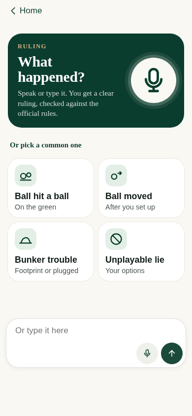
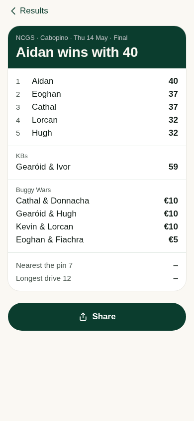
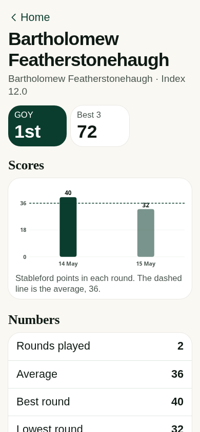
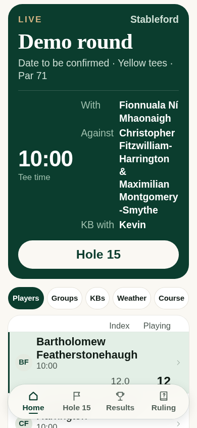
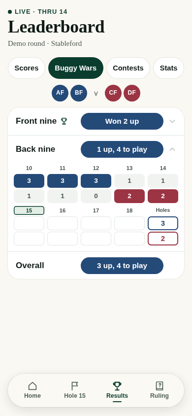
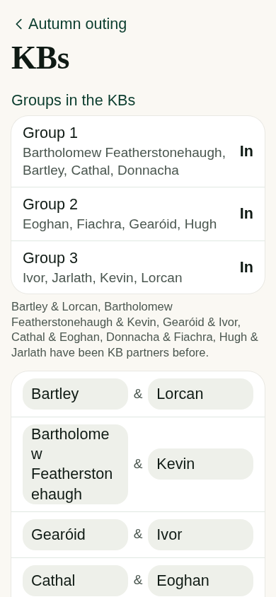
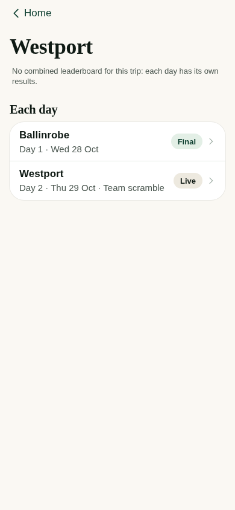

# NCGS screen-audit repairs

Implements the six finding groups from [the independent screen audit](https://github.com/Mikejpatterson/NCGS/blob/98a83d6370c888d53fda859d47043d84e8dfcab8/docs/review/SCREEN-AUDIT-2026-10-28.md). All screenshots use invented people and dates. This branch is a review candidate, not a live release.

## What changes

- **A01 — a way back:** if the floating navigation disappears while a member screen is open, the renderer supplies a return only when that screen has no existing return and no modal in charge. Home stays the root. No route, draft, queue or rejected-save data is cleared. Final individual/scramble entry controls become read-only and offer results instead of another Save.
- **A02 — readable results:** the share-card headline uses the approved light foreground on pine explicitly, so a generic title rule cannot make it disappear.
- **A03 — readable names:** personal headings fit their length within rem-based bounds and wrap safely. Names stay sans-serif and still grow with text settings. Phone player rows give names the row width; handicap numbers remain in their existing labelled columns. Long supporting names wrap rather than clip.
- **A04 — reference contrast:** active entry par references and scorecard par values use the stronger secondary-text token, checked against their actual backgrounds.
- **A05 — usable controls:** editable Buggy Wars nines use a five-column grid with full-size targets; the compact read-only scoreboard stays unchanged. KB choices have balanced partner columns and at least 44px targets. Course fields, the organiser exit and the scorecard's round link meet the same target size.
- **A06 — identifiable days:** trip links name the round, show its day/date/format and identify the state. Westport keeps separate daily results.

## Actual screens

### Return after play ends

Before: [Ruling had no route out](https://raw.githubusercontent.com/Mikejpatterson/NCGS/98a83d6370c888d53fda859d47043d84e8dfcab8/docs/review/screen-audit-2026-10-28/rules-ended.png).

### Shared result

Before: [the winner headline disappeared](https://raw.githubusercontent.com/Mikejpatterson/NCGS/98a83d6370c888d53fda859d47043d84e8dfcab8/docs/review/screen-audit-2026-10-28/share-result.png).

### Long names at 135% text

Before: [the profile ran beyond the viewport](https://raw.githubusercontent.com/Mikejpatterson/NCGS/98a83d6370c888d53fda859d47043d84e8dfcab8/docs/review/screen-audit-2026-10-28/long-profile.png).

### Editing and trip navigation

## Verification

`test/screen-audit.run.js` runs through the existing `test/layout.run.js` entry point; no workflow or second test orchestrator is added.

The navigation regression uses actual Home tabs and finalisation state changes. A real Save creates a durable request while a test-only retryable server failure holds it. A working draft is entered for the next hole. The simulated organiser finalises via the real local server, then syncs. Returning Home must preserve both the exact queued score and the working draft; once upload is refused because the round is final, the complete original request must remain in the existing rejected list.

The same suite measures result/reference contrast, long-name headings at 360/390/135%, target geometry, KB column balance and Westport's separate day navigation. It checks final entry is read-only, existing nested Back links are not duplicated, and Home receives no redundant return.

The PR description records current command results and whether they apply to the full candidate or a preceding presentation revision. The source guard, required engine/server tests, full layout chain and existing multi-phone/finish/start-hole checks remain in force. Local Chromium evidence is not a new physical-iPhone, keyboard or sunlight claim.

No scoring calculations, engine/server/core/data, real data, workflow, access or deployment configuration is changed. Human release approval remains required.
