# Whole-app identity continuation

The owner accepted62's results direction and asked for it to run through the entire application. This continuation applies a common component system across member and organiser pages, retaining the strong Home, play and draw compositions.

The shared reference is [APP-IDENTITY.md](../design/APP-IDENTITY.md). This contribution builds on62; it keeps that work and the existing roadmap/coordination system.

## Before and after across the application

All images are actual Chromium renders using the same fictional scenarios at390px. They are viewport samples; the coverage record and interaction suites also cover content below the fold and alternate states.

| Page family | Before | Shared identity |
| --- | --- | --- |
| Profile | 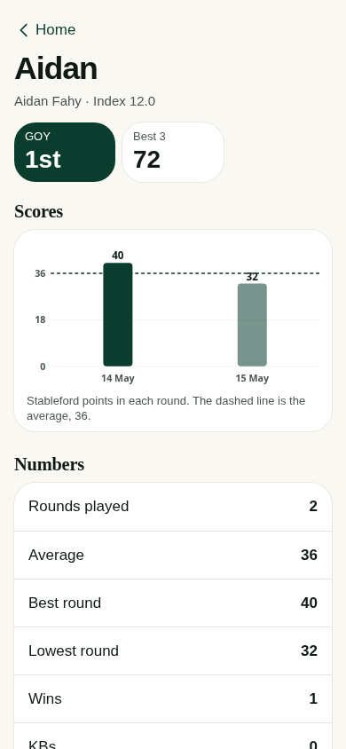 | 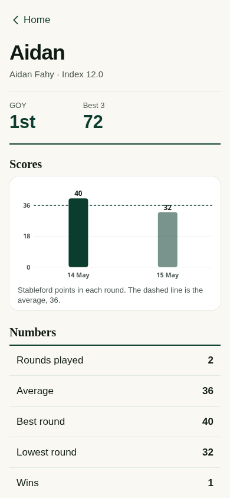 |
| Personal scorecard | 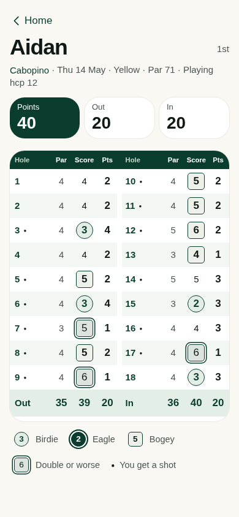 | 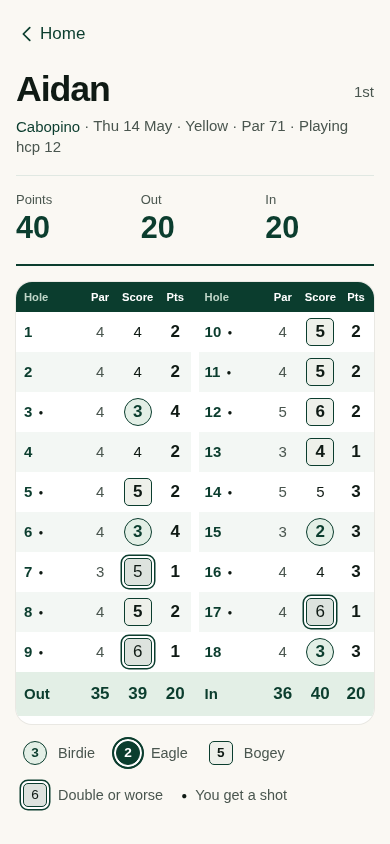 |
| Trip standings | 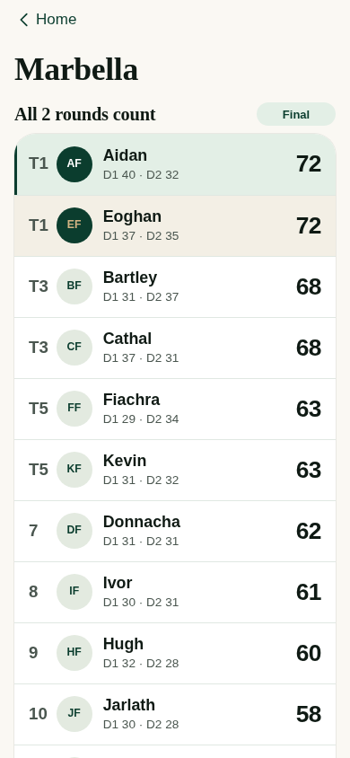 | 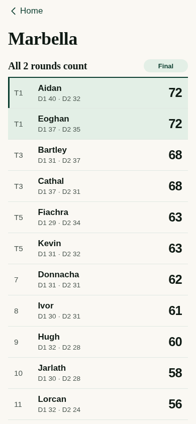 |
| Finished round | 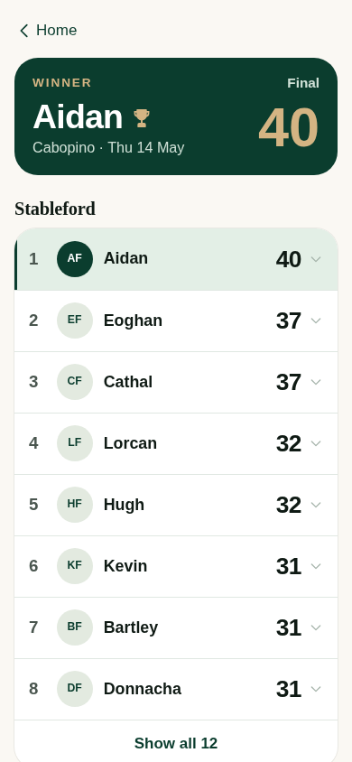 | 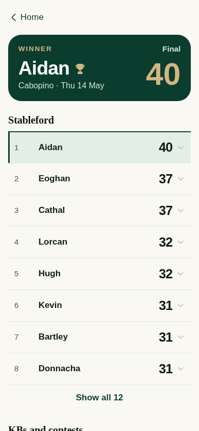 |
| Organiser settings | 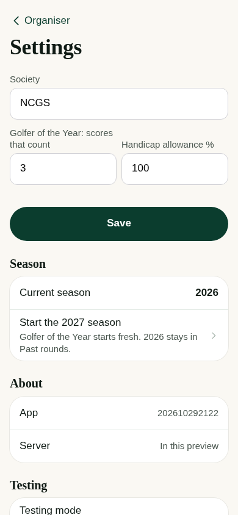 | 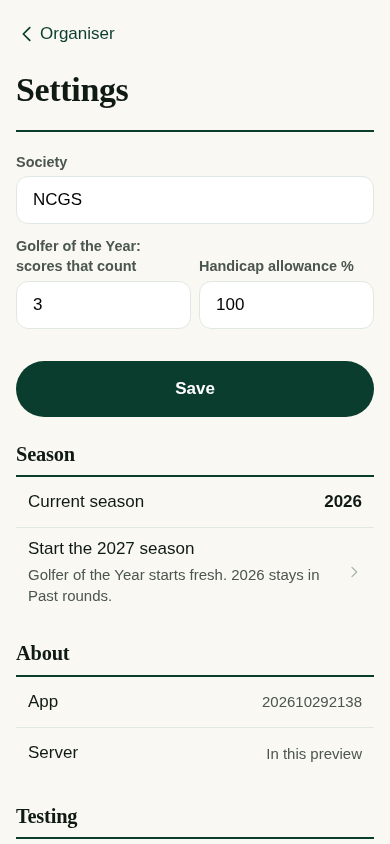 |
| Course editor | 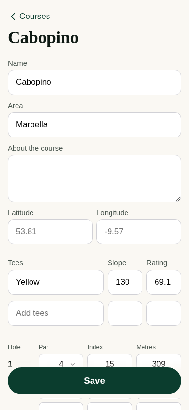 | 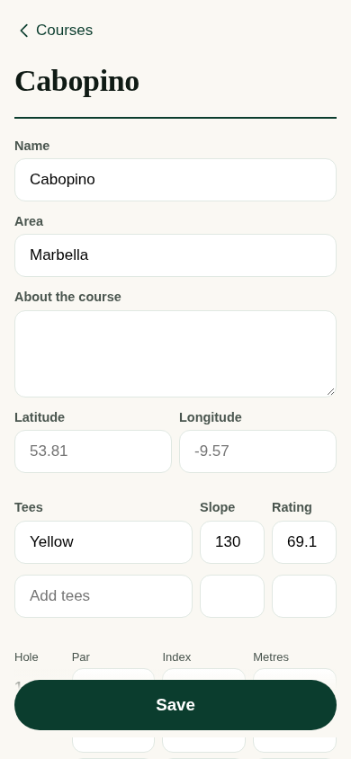 |

## The same identity with different emphasis

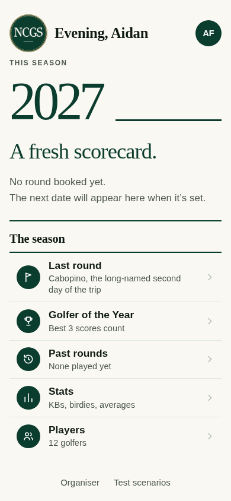

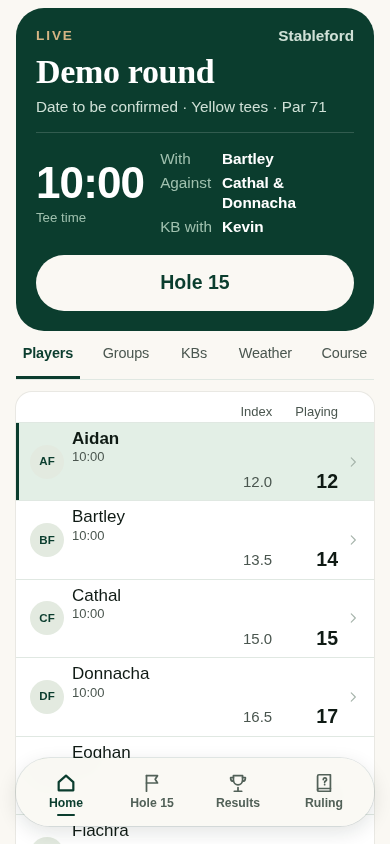

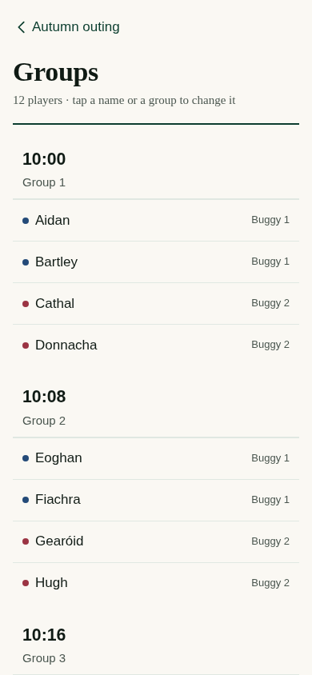

## What was checked

The source inventory contains49 rendering functions, including helper and legacy renderers. They are not49 independent current navigation destinations. The [coverage record](WHOLE-APP-IDENTITY-COVERAGE.csv) records the actual rendered route/content, alongside normal, small-phone and135% text observations.

The broad captures cover76 configured states at three sizes (228 records),74 long-name/large-text states and42 additional completion/card-check/error/overlay observations. Directly invoking a legacy/helper view can fall back to another view; those are identified in the record and do not count as successful end-to-end journeys. Valid supplemental captures and actual interaction suites cover the after-save, contest and scoring states.

The broader checks found a small Done target in the hole picker, outward-floating contest labels and a manual-scorecard name overrunning its column at large text. The final shared sheet rules correct those details. Enlarged-text checks preserve visible full names and the existing hidden screen-reader text.

The PR records completed command results and their exact limits. In addition to the unchanged strict layout and member journey suites, organiser/course checks and real-server multi-phone/full-day scenarios exercise preparation, ordinary scoring, scramble, draw, outages, finalisation and season standings. The full-day scenario scores one group through the phone interface and other groups over the same HTTP protocol, then independently checks results; it is not twelve physical golfers.

Local execution uses installed Chromium and a loopback adapter; automatic favicon requests get204 while actual missing resources and page errors remain failures. No test assertion is weakened. These checks do not establish physical-iPhone fonts, sunlight, native share UI or VoiceOver behaviour.

## Integration and safety

Only shared presentation rules and presentation-context data attributes change. All scoring, save handlers, permission checks, draft/outbox/rejected-save logic and existing tests remain intact. No real data, engine/server/core/data files, published-site files or workflows change.

This is a contribution into62's branch. Its existing source/site integration hold remains in force until a separately reviewed generated-site build is prepared. Neither a passing test nor agent review authorises a main merge or deployment. The human retains release authority.

## Rendering inventory

Helpers and legacy renderers are labelled here; route/state details are in the CSV above.

| Role | Renderer | Source | Coverage note |
| --- | --- | --- | --- |
| member | `home` | [20-society.js](../../src/app/20-society.js#L241) | Three viewport/text settings; shared family and journey checks |
| member | `rounds` | [20-society.js](../../src/app/20-society.js#L289) | Three viewport/text settings; shared family and journey checks |
| member | `players` | [20-society.js](../../src/app/20-society.js#L298) | Three viewport/text settings; shared family and journey checks |
| member | `goy` | [20-society.js](../../src/app/20-society.js#L312) | Three viewport/text settings; shared family and journey checks |
| member | `round` | [20-society.js](../../src/app/20-society.js#L544) | Three viewport/text settings; shared family and journey checks |
| member | `stats` | [20-society.js](../../src/app/20-society.js#L727) | Three viewport/text settings; shared family and journey checks |
| member | `player` | [20-society.js](../../src/app/20-society.js#L756) | Three viewport/text settings; shared family and journey checks |
| member | `card` | [20-society.js](../../src/app/20-society.js#L824) | Three viewport/text settings; shared family and journey checks |
| member | `who` | [20-society.js](../../src/app/20-society.js#L844) | Three viewport/text settings; shared family and journey checks |
| member | `ask` | [30-play.js](../../src/app/30-play.js#L36) | Shared contest helper reached through real scoring prompts |
| member | `tee` | [30-play.js](../../src/app/30-play.js#L79) | Delegating or legacy renderer; current scoring/Groups journeys additionally exercised |
| member | `rejected` | [30-play.js](../../src/app/30-play.js#L123) | Three viewport/text settings; shared family and journey checks |
| member | `entry` | [30-play.js](../../src/app/30-play.js#L232) | Three viewport/text settings; shared family and journey checks |
| member | `after` | [30-play.js](../../src/app/30-play.js#L409) | Valid supplemental snapshot plus actual Save journey; initial direct fixture fallback recorded |
| member | `check` | [30-play.js](../../src/app/30-play.js#L617) | Three viewport/text settings; shared family and journey checks |
| member | `finish` | [30-play.js](../../src/app/30-play.js#L708) | Three viewport/text settings; shared family and journey checks |
| member | `hcp` | [30-play.js](../../src/app/30-play.js#L742) | Three viewport/text settings; shared family and journey checks |
| member | `board` | [30-play.js](../../src/app/30-play.js#L844) | Three viewport/text settings; shared family and journey checks |
| member | `trip` | [30-play.js](../../src/app/30-play.js#L892) | Three viewport/text settings; shared family and journey checks |
| member | `results` | [30-play.js](../../src/app/30-play.js#L928) | Three viewport/text settings; shared family and journey checks |
| member | `scramble` | [32-scramble.js](../../src/app/32-scramble.js#L54) | Three viewport/text settings; shared family and journey checks |
| member | `scrambleFinish` | [32-scramble.js](../../src/app/32-scramble.js#L166) | Three viewport/text settings; shared family and journey checks |
| member | `rules` | [35-rules.js](../../src/app/35-rules.js#L241) | Three viewport/text settings; shared family and journey checks |
| org | `lock` | [40-org.js](../../src/app/40-org.js#L10) | Three viewport/text settings; shared family and journey checks |
| org | `home` | [40-org.js](../../src/app/40-org.js#L48) | Three viewport/text settings; shared family and journey checks |
| org | `round` | [40-org.js](../../src/app/40-org.js#L82) | Three viewport/text settings; shared family and journey checks |
| org | `details` | [40-org.js](../../src/app/40-org.js#L146) | Three viewport/text settings; shared family and journey checks |
| org | `playing` | [40-org.js](../../src/app/40-org.js#L179) | Delegating or legacy renderer; current scoring/Groups journeys additionally exercised |
| org | `groupsview` | [40-org.js](../../src/app/40-org.js#L207) | Delegating or legacy renderer; current scoring/Groups journeys additionally exercised |
| org | `kb` | [40-org.js](../../src/app/40-org.js#L216) | Three viewport/text settings; shared family and journey checks |
| org | `group` | [40-org.js](../../src/app/40-org.js#L237) | Three viewport/text settings; shared family and journey checks |
| org | `correct` | [40-org.js](../../src/app/40-org.js#L266) | Delegating or legacy renderer; current scoring/Groups journeys additionally exercised |
| org | `teamshots` | [40-org.js](../../src/app/40-org.js#L268) | Three viewport/text settings; shared family and journey checks |
| org | `contest` | [40-org.js](../../src/app/40-org.js#L274) | Supplemental live-contest fixture plus organiser journey |
| org | `guest` | [40-org.js](../../src/app/40-org.js#L289) | Three viewport/text settings; shared family and journey checks |
| org | `late` | [40-org.js](../../src/app/40-org.js#L305) | Three viewport/text settings; shared family and journey checks |
| org | `members` | [40-org.js](../../src/app/40-org.js#L332) | Three viewport/text settings; shared family and journey checks |
| org | `member` | [40-org.js](../../src/app/40-org.js#L342) | Three viewport/text settings; shared family and journey checks |
| org | `courses` | [40-org.js](../../src/app/40-org.js#L359) | Three viewport/text settings; shared family and journey checks |
| org | `course` | [40-org.js](../../src/app/40-org.js#L366) | Three viewport/text settings; shared family and journey checks |
| org | `settings` | [40-org.js](../../src/app/40-org.js#L407) | Three viewport/text settings; shared family and journey checks |
| org | `log` | [40-org.js](../../src/app/40-org.js#L423) | Three viewport/text settings; shared family and journey checks |
| org | `export` | [40-org.js](../../src/app/40-org.js#L447) | Three viewport/text settings; shared family and journey checks |
| org | `drawhome` | [42-draw.js](../../src/app/42-draw.js#L105) | Three viewport/text settings; shared family and journey checks |
| org | `pots` | [42-draw.js](../../src/app/42-draw.js#L124) | Three viewport/text settings; shared family and journey checks |
| org | `draw` | [42-draw.js](../../src/app/42-draw.js#L137) | Three viewport/text settings; shared family and journey checks |
| org | `drawlineup` | [42-draw.js](../../src/app/42-draw.js#L180) | Three viewport/text settings; shared family and journey checks |
| org | `groups` | [44-groups.js](../../src/app/44-groups.js#L42) | Three viewport/text settings; shared family and journey checks |
| member | `scenarios` | [45-preview.js](../../src/app/45-preview.js#L2) | Preview-only screen; styled for completeness |
