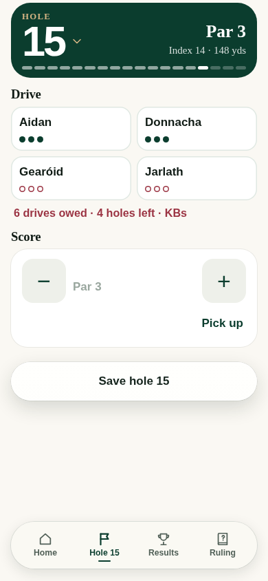
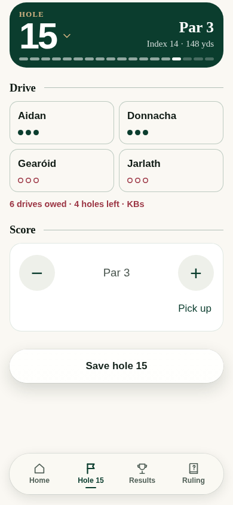
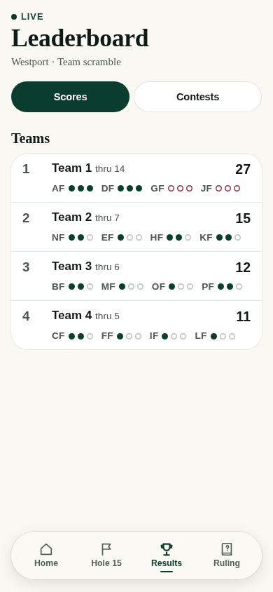
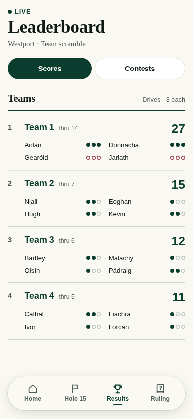

# Westport presentation study — actual application renders

Based on PR #41 head `ce5e8ca3efc06232663b33940f1d13e200229265`.
This isolated contribution changes presentation only. Claude owns integration;
nothing has been merged into #41, design or main, and nothing has been deployed.

## Design decision

Replace the cramped initials-and-dots strip with a two-column named drive ledger
for every team. Keep all four teams and each player's three-drive progress visible.
Keep rank quiet, points aligned, and the existing conditional warnings/KB labels.

On the hole screen, preserve Drive before Score. Calm the selection cards, use pine
rules to connect the section headings, centre the score, and give the two score
buttons a consistent circular treatment. Preserve names, drive selection, dots,
minimum-drive warnings, Save, Pick up and all existing action/ARIA attributes.

No changes to scrSave, scrDraft, storage, engine, conflict semantics, roster locks,
format or individual-result exclusions. Home's compact board is retained; the
full team board is where every team's named drive ledger appears.

## Actual Chromium views

Fictional fixture data, 390px phone viewport. These are genuine application renders,
not illustrative mockups. Before and after use the same Westport scenario.

| View | Before | Proposed |
| --- | --- | --- |
| Hole |  |  |
| Teams |  |  |

Additional local renders cover 360px, 390px and 390px with 135% text, with no horizontal
overflow or script errors. No real phone, sunlight or physical tablet pass is claimed.

## Validation

- All eleven existing unit test files pass locally, including engine/server/fuzz and
  scramble/server cases; Node24 reports file entries, not the Node22 individual-test count.
- Existing scramble two-phone regression passes: saved strokes, stale offline queue,
  API-down reload, unresolved A6+B4 preservation, recovery, and roster action guards.
- Full unchanged layout entry point passes: 161 PASS lines, zero FAIL lines, exit 0, including
  Home, seasons, scenarios, scramble and contest-order suites. No assertions were relaxed.
- The local-only runtime adapter selects installed Chromium and loopback HTTP.
  Assertions are unchanged. No production endpoint or real seed is used.

